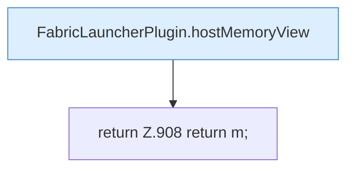

[[00 Start]] › [[Plugin-Kern]] › [[Diagnose]] › [[FabricLauncherPlugin.diagMap(String)]] › [[FabricLauncherPlugin.diagMap(String).Teil3]]

# FabricLauncherPlugin.diagMap(String).Teil3



```knoten
FabricLauncherPlugin.hostMemoryView
  Stellt die Speichermessung so zusammen, wie die [[Glossar#Bedienseite|Bedienseite]] sie zeigt. Betrifft den [[Glossar#Host|Host]] `hostMemoryView`. Ruft `view`, `cgroupUsePercent`, `emergencyStopStarted`.
return Z.908 return m;
  Zeile 908: Rückgabe `return m;`.
```

> [!knoten]- Was die Blöcke tun
> - **FabricLauncherPlugin.hostMemoryView**: Stellt die Speichermessung so zusammen, wie die [[Glossar#Bedienseite|Bedienseite]] sie zeigt. Betrifft den [[Glossar#Host|Host]] `hostMemoryView`. Ruft `view`, `cgroupUsePercent`, `emergencyStopStarted`.
> - **return Z.908 return m;**: Zeile 908: Rückgabe `return m;`.

- Ein weiterer Abschnitt derselben Übersicht.
- Fortsetzung von `FabricLauncherPlugin.diagMap(String)`.
