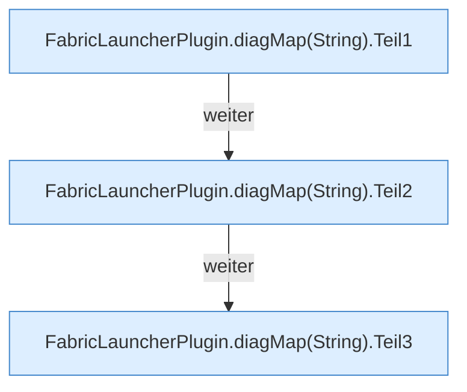

[[00 Start]] › [[Plugin-Kern]] › [[Diagnose]] › [[FabricLauncherPlugin.diagMap(String)]]

# FabricLauncherPlugin.diagMap(String)

`FabricLauncherPlugin.diagMap(String id)` [src/main/java/de/aichele/childlauncher/FabricLauncherPlugin.java:880–909](https://github.com/Sciddie/minecraft-serverhoster-plugin/blob/95b02b953b0b4c23673e900e021a7c3c844aa37d/src/main/java/de/aichele/childlauncher/FabricLauncherPlugin.java#L880-L909)

- `diagMap` in `src/main/java/de/aichele/childlauncher/FabricLauncherPlugin.java`
