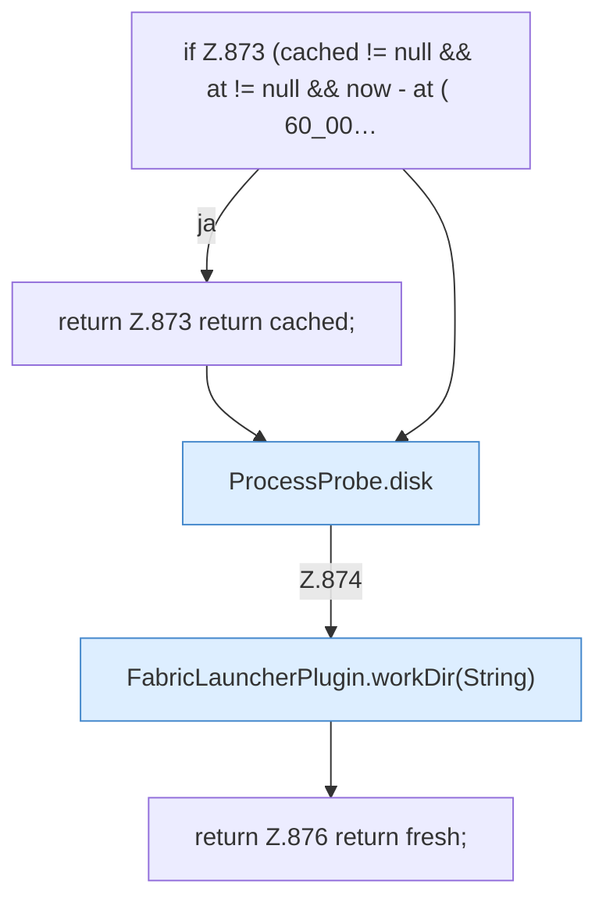

[[00 Start]] › [[Plugin-Kern]] › [[Diagnose]] › [[FabricLauncherPlugin.diskCached]]

# FabricLauncherPlugin.diskCached

`FabricLauncherPlugin.diskCached(String id)` [src/main/java/de/aichele/childlauncher/FabricLauncherPlugin.java:869–877](https://github.com/Sciddie/minecraft-serverhoster-plugin/blob/95b02b953b0b4c23673e900e021a7c3c844aa37d/src/main/java/de/aichele/childlauncher/FabricLauncherPlugin.java#L869-L877)



```knoten
if Z.873 (cached != null && at != null && now - at ( 60_00…
  Zeile 873: prüft `(cached != null && at != null && now - at ( 60_00…`.
return Z.873 return cached;
  Zeile 873: Rückgabe `return cached;`.
ProcessProbe.disk
  Liest die Platte `disk`.
FabricLauncherPlugin.workDir(String)
  `workDir` in `FabricLauncherPlugin.java`. Ruft `profile`, `directory`.
return Z.876 return fresh;
  Zeile 876: Rückgabe `return fresh;`.
```

- `diskCached` in `src/main/java/de/aichele/childlauncher/FabricLauncherPlugin.java`
