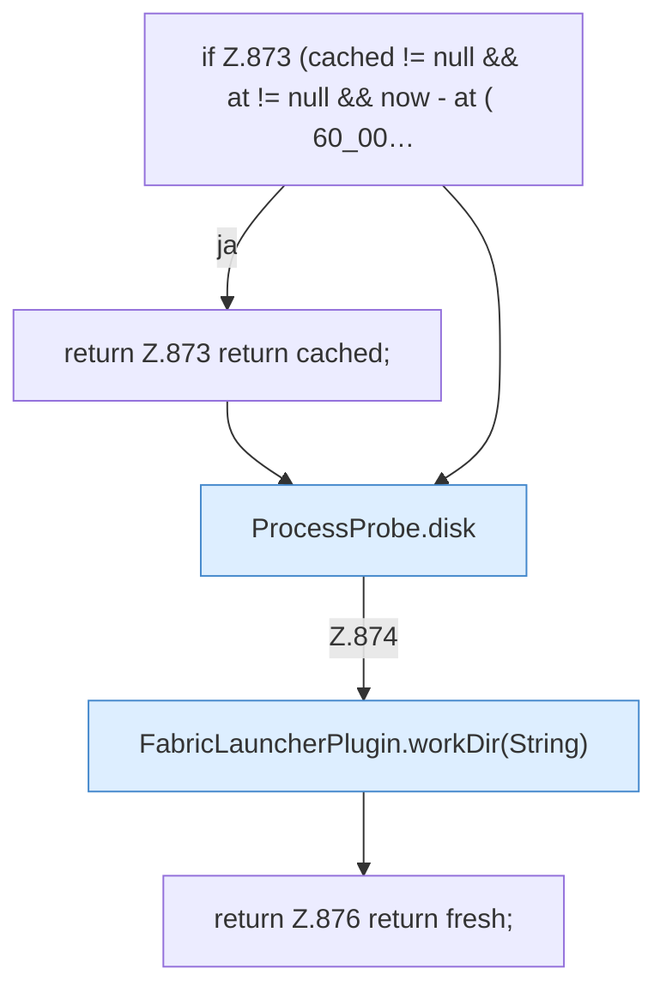

[[00 Start]] › [[Plugin-Kern]] › [[Diagnose]] › [[FabricLauncherPlugin.diskCached]]

# FabricLauncherPlugin.diskCached

`FabricLauncherPlugin.diskCached(String id)` [src/main/java/de/aichele/childlauncher/FabricLauncherPlugin.java:869–877](https://github.com/Sciddie/minecraft-serverhoster-plugin/blob/95b02b953b0b4c23673e900e021a7c3c844aa37d/src/main/java/de/aichele/childlauncher/FabricLauncherPlugin.java#L869-L877)



```knoten
if Z.873 (cached != null && at != null && now - at ( 60_00…
  Hier fällt eine Entscheidung. Nur wenn sie zutrifft, geht es den Ja-Weg weiter. Das steht in [[Glossar#Zeile|Zeile]] 873.
return Z.873 return cached;
  Hier endet die [[Glossar#Funktion|Funktion]] und liefert ein Ergebnis zurück. Das steht in [[Glossar#Zeile|Zeile]] 873.
ProcessProbe.disk
  Dieser Teil macht hier einen einzelnen Schritt. Eine Ebene tiefer steht er genauer. Im [[Glossar#Quelltext|Quelltext]] heißt das `disk`.
FabricLauncherPlugin.workDir(String)
  Liefert den Ordner, in dem der [[Glossar#Spielserver|Spielserver]] arbeitet. Im [[Glossar#Quelltext|Quelltext]] heißt das `workDir(String)`.
return Z.876 return fresh;
  Hier endet die [[Glossar#Funktion|Funktion]] und liefert ein Ergebnis zurück. Das steht in [[Glossar#Zeile|Zeile]] 876.
```

> [!knoten]- Was die Blöcke tun
> - **if Z.873 (cached != null && at != null && now - at ( 60_00…**: Hier fällt eine Entscheidung. Nur wenn sie zutrifft, geht es den Ja-Weg weiter. Das steht in [[Glossar#Zeile|Zeile]] 873.
> - **return Z.873 return cached;**: Hier endet die [[Glossar#Funktion|Funktion]] und liefert ein Ergebnis zurück. Das steht in [[Glossar#Zeile|Zeile]] 873.
> - **ProcessProbe.disk**: Dieser Teil macht hier einen einzelnen Schritt. Eine Ebene tiefer steht er genauer. Im [[Glossar#Quelltext|Quelltext]] heißt das `disk`.
> - **FabricLauncherPlugin.workDir(String)**: Liefert den Ordner, in dem der [[Glossar#Spielserver|Spielserver]] arbeitet. Im [[Glossar#Quelltext|Quelltext]] heißt das `workDir(String)`.
> - **return Z.876 return fresh;**: Hier endet die [[Glossar#Funktion|Funktion]] und liefert ein Ergebnis zurück. Das steht in [[Glossar#Zeile|Zeile]] 876.

- Sagt, wie voll die Festplatte ist. Der Wert darf kurz zwischengespeichert sein.
