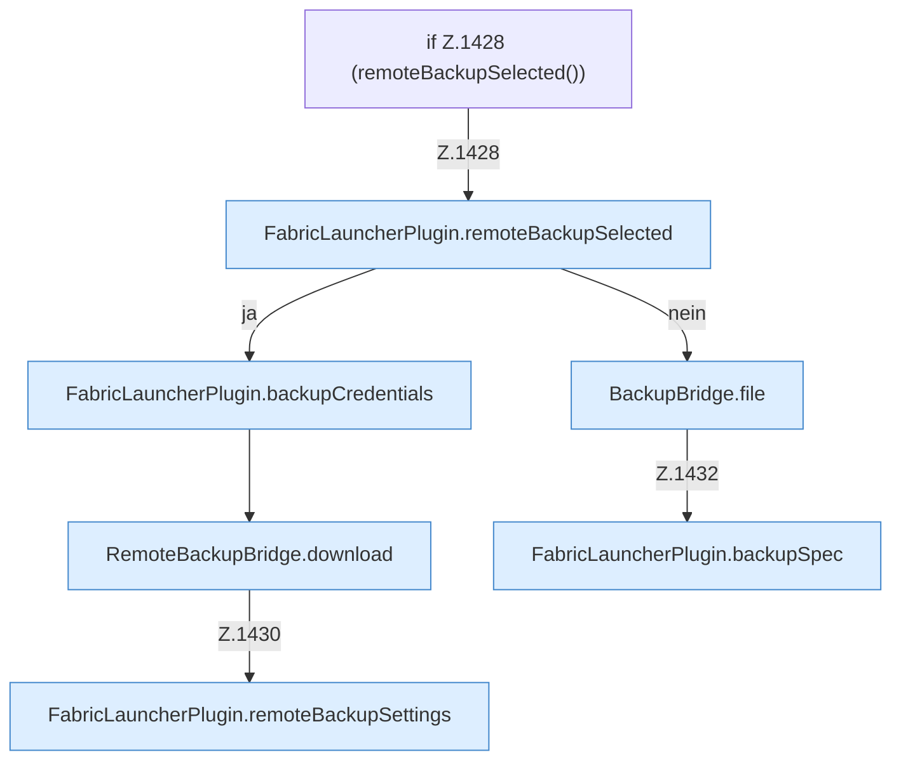

[[00 Start]] › [[Backup]] › [[Backup-Dateien]] › [[FabricLauncherPlugin.downloadBackup]] › [[FabricLauncherPlugin.downloadBackup.Z1428]]

# FabricLauncherPlugin.downloadBackup.Z1428



```knoten
if Z.1428 (remoteBackupSelected())
  Zeile 1428: prüft `(remoteBackupSelected())`.
FabricLauncherPlugin.remoteBackupSelected
  `remoteBackupSelected` in `FabricLauncherPlugin.java`.
FabricLauncherPlugin.backupCredentials
  Sichert `backupCredentials`. Ruft `load`.
RemoteBackupBridge.download
  Liefert zum Herunterladen `download`. Ruft `safeId`, `named`, `connect`.
FabricLauncherPlugin.remoteBackupSettings
  `remoteBackupSettings` in `FabricLauncherPlugin.java`.
BackupBridge.file
  Liefert die Datei `file`. Ruft `safeId`, `named`, `directory`.
FabricLauncherPlugin.backupSpec
  Sichert `backupSpec`.
```

- Fortsetzung von `FabricLauncherPlugin.downloadBackup`, Quellreihenfolge.
