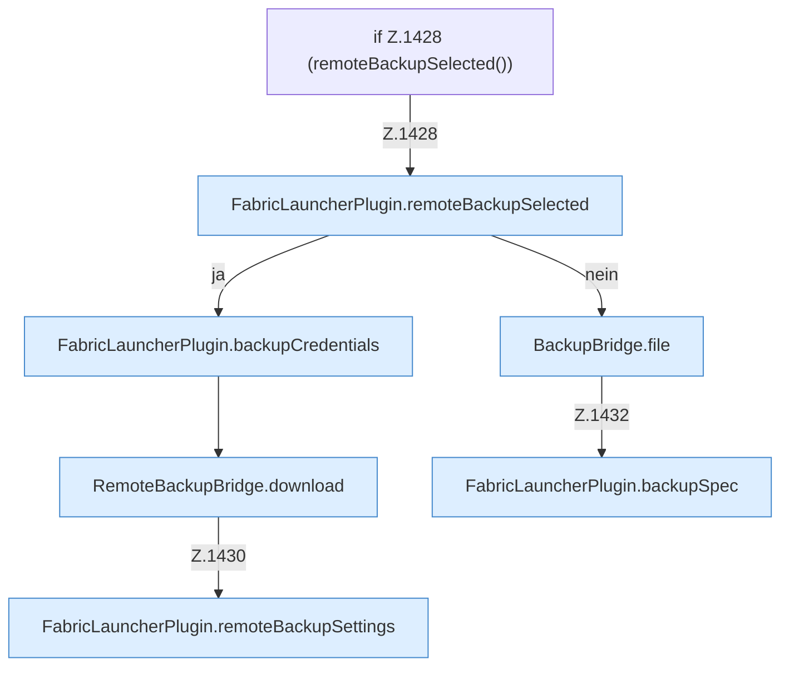

[[00 Start]] › [[Backup]] › [[Backup-Dateien]] › [[FabricLauncherPlugin.downloadBackup]] › [[FabricLauncherPlugin.downloadBackup.Z1428]]

# FabricLauncherPlugin.downloadBackup.Z1428

- Fortsetzung von `FabricLauncherPlugin.downloadBackup`, Quellreihenfolge.
