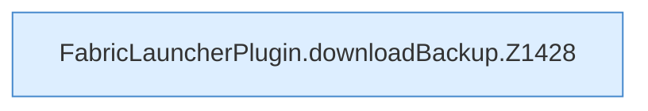

[[00 Start]] › [[Backup]] › [[Backup-Dateien]] › [[FabricLauncherPlugin.downloadBackup]]

# FabricLauncherPlugin.downloadBackup

`FabricLauncherPlugin.downloadBackup(String id, String name, OutputStream output)` [src/main/java/de/aichele/childlauncher/FabricLauncherPlugin.java:1427–1434](https://github.com/Sciddie/minecraft-serverhoster-plugin/blob/95b02b953b0b4c23673e900e021a7c3c844aa37d/src/main/java/de/aichele/childlauncher/FabricLauncherPlugin.java#L1427-L1434)

- `downloadBackup` in `src/main/java/de/aichele/childlauncher/FabricLauncherPlugin.java`
