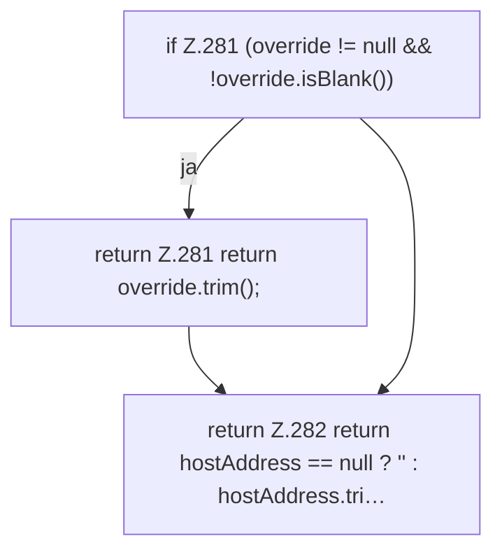

[[00 Start]] › [[Plugin-Kern]] › [[Bind-Adresse]] › [[FabricLauncherPlugin.effectiveBindAddress]]

# FabricLauncherPlugin.effectiveBindAddress

`FabricLauncherPlugin.effectiveBindAddress(String override, String hostAddress)` [src/main/java/de/aichele/childlauncher/FabricLauncherPlugin.java:280–283](https://github.com/Sciddie/minecraft-serverhoster-plugin/blob/95b02b953b0b4c23673e900e021a7c3c844aa37d/src/main/java/de/aichele/childlauncher/FabricLauncherPlugin.java#L280-L283)



```knoten
if Z.281 (override != null && !override.isBlank())
  Hier fällt eine Entscheidung. Nur wenn sie zutrifft, geht es den Ja-Weg weiter. Das steht in [[Glossar#Zeile|Zeile]] 281.
return Z.281 return override.trim();
  Hier endet die [[Glossar#Funktion|Funktion]] und liefert ein Ergebnis zurück. Das steht in [[Glossar#Zeile|Zeile]] 281.
return Z.282 return hostAddress == null ? '' : hostAddress.tri…
  Hier endet die [[Glossar#Funktion|Funktion]] und liefert ein Ergebnis zurück. Das steht in [[Glossar#Zeile|Zeile]] 282.
```

> [!knoten]- Was die Blöcke tun
> - **if Z.281 (override != null && !override.isBlank())**: Hier fällt eine Entscheidung. Nur wenn sie zutrifft, geht es den Ja-Weg weiter. Das steht in [[Glossar#Zeile|Zeile]] 281.
> - **return Z.281 return override.trim();**: Hier endet die [[Glossar#Funktion|Funktion]] und liefert ein Ergebnis zurück. Das steht in [[Glossar#Zeile|Zeile]] 281.
> - **return Z.282 return hostAddress == null ? '' : hostAddress.tri…**: Hier endet die [[Glossar#Funktion|Funktion]] und liefert ein Ergebnis zurück. Das steht in [[Glossar#Zeile|Zeile]] 282.

- Die Adresse, die nach allen Ersatzregeln wirklich gilt.
