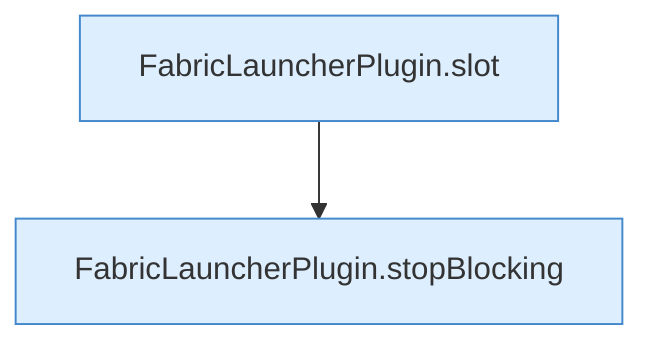

[[00 Start]] › [[Zeitplaene]] › [[Tasks]] › [[FabricLauncherPlugin.executeTask]] › [[FabricLauncherPlugin.executeTask.Z1331.Case1333]]

# FabricLauncherPlugin.executeTask.Z1331.Case1333



```knoten
FabricLauncherPlugin.slot
  Das [[Glossar#Plugin|Plugin]] macht hier einen einzelnen Schritt. Eine Ebene tiefer steht er genauer. `slot` in `FabricLauncherPlugin.java`. Ruft `profile`, `ChildSlot`.
FabricLauncherPlugin.stopBlocking
  Setzt den Zustand auf „stoppt“ und wartet, bis der [[Glossar#Spielserver|Spielserver]] wirklich aus ist. Stoppt `stopBlocking`. Ruft `invalidateRestarts`, `running`, `stopProcess`.
```

> [!knoten]- Was die Blöcke tun
> - **FabricLauncherPlugin.slot**: Das [[Glossar#Plugin|Plugin]] macht hier einen einzelnen Schritt. Eine Ebene tiefer steht er genauer. `slot` in `FabricLauncherPlugin.java`. Ruft `profile`, `ChildSlot`.
> - **FabricLauncherPlugin.stopBlocking**: Setzt den Zustand auf „stoppt“ und wartet, bis der [[Glossar#Spielserver|Spielserver]] wirklich aus ist. Stoppt `stopBlocking`. Ruft `invalidateRestarts`, `running`, `stopProcess`.

- Das Innere eines Wegs, ab [[Glossar#Zeile|Zeile]] 1333.
- Fortsetzung von `FabricLauncherPlugin.executeTask.Z1331`.
