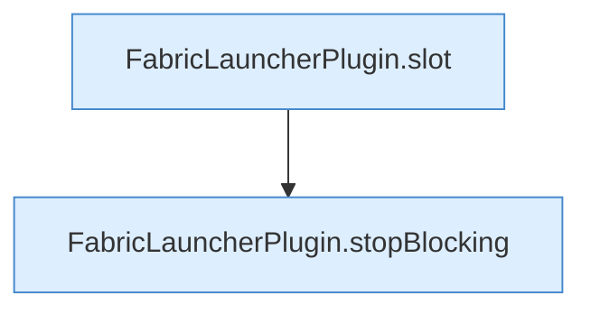

[[00 Start]] › [[Zeitplaene]] › [[Tasks]] › [[FabricLauncherPlugin.executeTask]] › [[FabricLauncherPlugin.executeTask.Z1331.Case1333]]

# FabricLauncherPlugin.executeTask.Z1331.Case1333



```knoten
FabricLauncherPlugin.slot
  `slot` in `FabricLauncherPlugin.java`. Ruft `profile`, `ChildSlot`.
FabricLauncherPlugin.stopBlocking
  Stoppt `stopBlocking`. Ruft `invalidateRestarts`, `running`, `stopProcess`.
```

- Fortsetzung von `FabricLauncherPlugin.executeTask.Z1331`, Quellreihenfolge.
