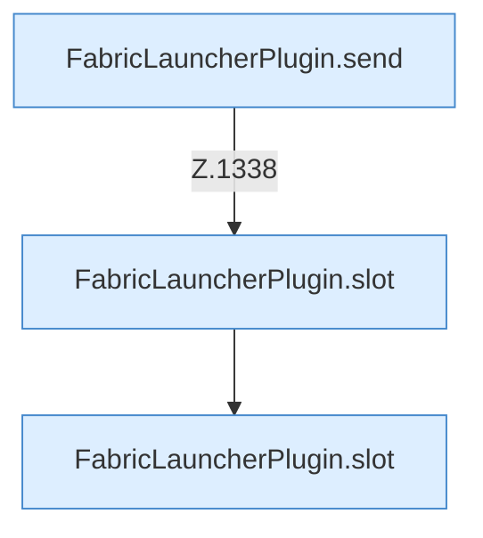

[[00 Start]] › [[Zeitplaene]] › [[Tasks]] › [[FabricLauncherPlugin.executeTask]] › [[FabricLauncherPlugin.executeTask.Z1331.Case1336]]

# FabricLauncherPlugin.executeTask.Z1331.Case1336



```knoten
FabricLauncherPlugin.send
  Schickt Text an den laufenden [[Glossar#Spielserver|Spielserver]]. Sendet `send`. Ruft `running`.
FabricLauncherPlugin.slot
  Das [[Glossar#Plugin|Plugin]] macht hier einen einzelnen Schritt. Eine Ebene tiefer steht er genauer. `slot` in `FabricLauncherPlugin.java`. Ruft `profile`, `ChildSlot`.
```

> [!knoten]- Was die Blöcke tun
> - **FabricLauncherPlugin.send**: Schickt Text an den laufenden [[Glossar#Spielserver|Spielserver]]. Sendet `send`. Ruft `running`.
> - **FabricLauncherPlugin.slot**: Das [[Glossar#Plugin|Plugin]] macht hier einen einzelnen Schritt. Eine Ebene tiefer steht er genauer. `slot` in `FabricLauncherPlugin.java`. Ruft `profile`, `ChildSlot`.

- Das Innere eines Wegs, ab [[Glossar#Zeile|Zeile]] 1336.
- Fortsetzung von `FabricLauncherPlugin.executeTask.Z1331`.
