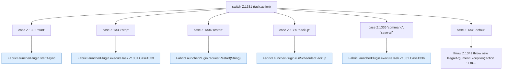

[[00 Start]] › [[Zeitplaene]] › [[Tasks]] › [[FabricLauncherPlugin.executeTask]] › [[FabricLauncherPlugin.executeTask.Z1331]]

# FabricLauncherPlugin.executeTask.Z1331



```knoten
switch Z.1331 (task.action)
  Zeile 1331: Verzweigung nach `(task.action)`.
case Z.1332 'start'
  Zeile 1332: Zweig `'start'`.
FabricLauncherPlugin.startAsync
  Startet `startAsync`. Ruft `msg`, `slot`, `invalidateRestarts`.
case Z.1333 'stop'
  Zeile 1333: Zweig `'stop'`.
FabricLauncherPlugin.executeTask.Z1331.Case1333
  Rumpf dieses switch-Zweigs ab Zeile 1333.
case Z.1334 'restart'
  Zeile 1334: Zweig `'restart'`.
FabricLauncherPlugin.requestRestart(String)
  Fordert an `requestRestart`. Ruft `slot`, `stopBlocking`, `reloadProfiles`.
case Z.1335 'backup'
  Zeile 1335: Zweig `'backup'`.
FabricLauncherPlugin.runScheduledBackup
  Führt aus `runScheduledBackup`. Ruft `slot`, `running`, `add`.
case Z.1336 'command', 'save-all'
  Zeile 1336: Zweig `'command', 'save-all'`.
FabricLauncherPlugin.executeTask.Z1331.Case1336
  Rumpf dieses switch-Zweigs ab Zeile 1336.
case Z.1341 default
  Zeile 1341: Zweig `default`.
throw Z.1341 throw new IllegalArgumentException('action ' + ta…
  Zeile 1341: Abbruch `throw new IllegalArgumentException('action ' + ta…`.
```

- Fortsetzung von `FabricLauncherPlugin.executeTask`, Quellreihenfolge.
