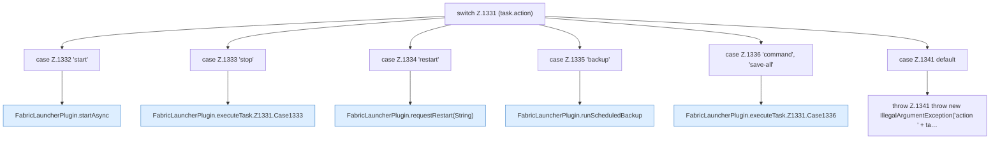

[[00 Start]] › [[Zeitplaene]] › [[Tasks]] › [[FabricLauncherPlugin.executeTask]] › [[FabricLauncherPlugin.executeTask.Z1331]]

# FabricLauncherPlugin.executeTask.Z1331

- Fortsetzung von `FabricLauncherPlugin.executeTask`, Quellreihenfolge.
