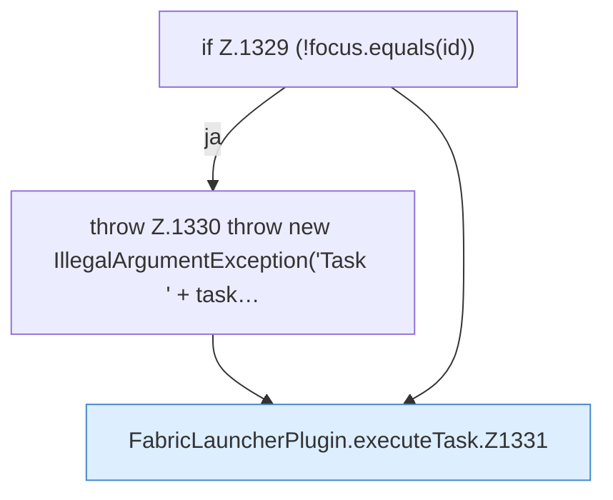

[[00 Start]] › [[Zeitplaene]] › [[Tasks]] › [[FabricLauncherPlugin.executeTask]]

# FabricLauncherPlugin.executeTask

`FabricLauncherPlugin.executeTask(TaskDef task)` [src/main/java/de/aichele/childlauncher/FabricLauncherPlugin.java:1327–1343](https://github.com/Sciddie/minecraft-serverhoster-plugin/blob/95b02b953b0b4c23673e900e021a7c3c844aa37d/src/main/java/de/aichele/childlauncher/FabricLauncherPlugin.java#L1327-L1343)



```knoten
if Z.1329 (!focus.equals(id))
  Hier fällt eine Entscheidung. Nur wenn sie zutrifft, geht es den Ja-Weg weiter. Das steht in [[Glossar#Zeile|Zeile]] 1329.
throw Z.1330 throw new IllegalArgumentException('Task ' + task…
  Hier bricht die [[Glossar#Funktion|Funktion]] ab, weil etwas nicht geklappt hat. Das steht in [[Glossar#Zeile|Zeile]] 1330.
FabricLauncherPlugin.executeTask.Z1331
  Der Ablauf geht in [[Glossar#Zeile|Zeile]] 1331 weiter. Eine Ebene tiefer steht er genauer. Im [[Glossar#Quelltext|Quelltext]] heißt das `Z1331`.
```

> [!knoten]- Was die Blöcke tun
> - **if Z.1329 (!focus.equals(id))**: Hier fällt eine Entscheidung. Nur wenn sie zutrifft, geht es den Ja-Weg weiter. Das steht in [[Glossar#Zeile|Zeile]] 1329.
> - **throw Z.1330 throw new IllegalArgumentException('Task ' + task…**: Hier bricht die [[Glossar#Funktion|Funktion]] ab, weil etwas nicht geklappt hat. Das steht in [[Glossar#Zeile|Zeile]] 1330.
> - **FabricLauncherPlugin.executeTask.Z1331**: Der Ablauf geht in [[Glossar#Zeile|Zeile]] 1331 weiter. Eine Ebene tiefer steht er genauer. Im [[Glossar#Quelltext|Quelltext]] heißt das `Z1331`.

- Das [[Glossar#Plugin|Plugin]] führt aus die [[Glossar#Aufgabe|Aufgabe]].
