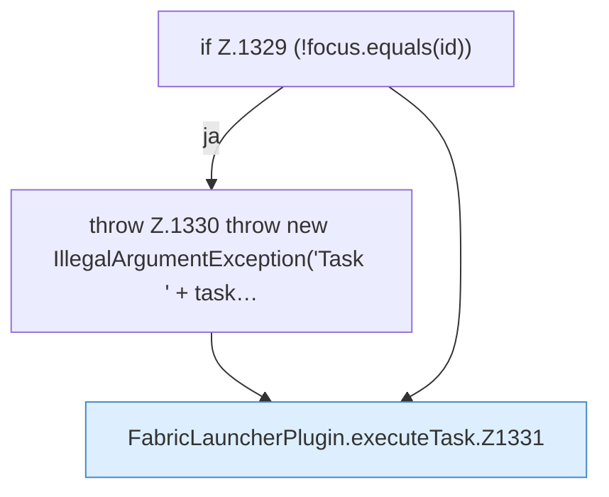

[[00 Start]] › [[Zeitplaene]] › [[Tasks]] › [[FabricLauncherPlugin.executeTask]]

# FabricLauncherPlugin.executeTask

`FabricLauncherPlugin.executeTask(TaskDef task)` [src/main/java/de/aichele/childlauncher/FabricLauncherPlugin.java:1327–1343](https://github.com/Sciddie/minecraft-serverhoster-plugin/blob/95b02b953b0b4c23673e900e021a7c3c844aa37d/src/main/java/de/aichele/childlauncher/FabricLauncherPlugin.java#L1327-L1343)



```knoten
if Z.1329 (!focus.equals(id))
  Zeile 1329: prüft `(!focus.equals(id))`.
throw Z.1330 throw new IllegalArgumentException('Task ' + task…
  Zeile 1330: Abbruch `throw new IllegalArgumentException('Task ' + task…`.
FabricLauncherPlugin.executeTask.Z1331
  Fortsetzung des Ablaufs ab Zeile 1331.
```

- `executeTask` in `src/main/java/de/aichele/childlauncher/FabricLauncherPlugin.java`
