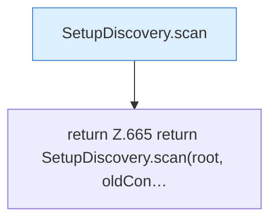

[[00 Start]] › [[Plugin-Kern]] › [[Setup]] › [[Setup-Dialog]] › [[FabricLauncherPlugin.findSetupCandidate]]

# FabricLauncherPlugin.findSetupCandidate

`FabricLauncherPlugin.findSetupCandidate(Path root, String path)` [src/main/java/de/aichele/childlauncher/FabricLauncherPlugin.java:662–668](https://github.com/Sciddie/minecraft-serverhoster-plugin/blob/95b02b953b0b4c23673e900e021a7c3c844aa37d/src/main/java/de/aichele/childlauncher/FabricLauncherPlugin.java#L662-L668)



```knoten
SetupDiscovery.scan
  Durchsucht `scan`. Ruft `legacyPluginVersion`, `isAtLeast`, `loadLegacyConfig`.
return Z.665 return SetupDiscovery.scan(root, oldCon…
  Zeile 665: Rückgabe `return SetupDiscovery.scan(root, oldCon…`.
```

- `findSetupCandidate` in `src/main/java/de/aichele/childlauncher/FabricLauncherPlugin.java`
