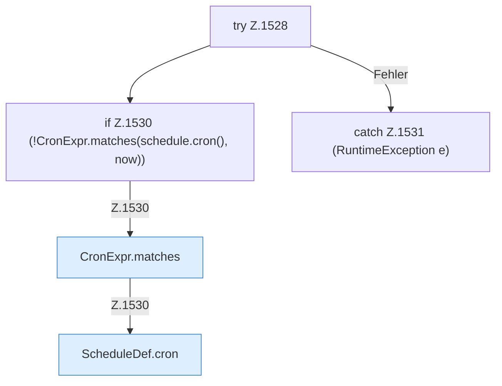

[[00 Start]] › [[Zeitplaene]] › [[Schedules]] › [[FabricLauncherPlugin.fireDueSchedules]] › [[FabricLauncherPlugin.fireDueSchedules.Z1525.Z1528]]

# FabricLauncherPlugin.fireDueSchedules.Z1525.Z1528

- Fortsetzung von `FabricLauncherPlugin.fireDueSchedules.Z1525`, Quellreihenfolge.
