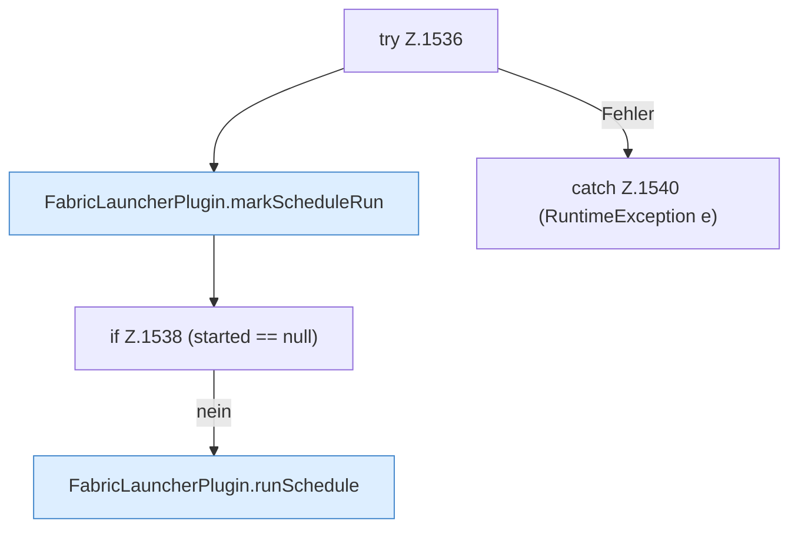

[[00 Start]] › [[Zeitplaene]] › [[Schedules]] › [[FabricLauncherPlugin.fireDueSchedules]] › [[FabricLauncherPlugin.fireDueSchedules.Z1525.Z1536]]

# FabricLauncherPlugin.fireDueSchedules.Z1525.Z1536



```knoten
try Z.1536
  Zeile 1536: Versuch. Der Fehlerpfad geht in catch.
FabricLauncherPlugin.markScheduleRun
  Das [[Glossar#Plugin|Plugin]] merkt sich den [[Glossar#Zeitplan|Zeitplan]] den Lauf. Merkt `markScheduleRun`. Ruft `schedules`, `sameScheduleMinute`, `withLastRun`.
if Z.1538 (started == null)
  Zeile 1538: prüft `(started == null)`.
FabricLauncherPlugin.runSchedule
  Das [[Glossar#Plugin|Plugin]] führt aus den [[Glossar#Zeitplan|Zeitplan]]. Führt aus `runSchedule`. Ruft `noteTask`, `run`, `TaskDef`.
catch Z.1540 (RuntimeException e)
  Zeile 1540: fängt (RuntimeException e).
```

> [!knoten]- Was die Blöcke tun
> - **try Z.1536**: Zeile 1536: Versuch. Der Fehlerpfad geht in catch.
> - **FabricLauncherPlugin.markScheduleRun**: Das [[Glossar#Plugin|Plugin]] merkt sich den [[Glossar#Zeitplan|Zeitplan]] den Lauf. Merkt `markScheduleRun`. Ruft `schedules`, `sameScheduleMinute`, `withLastRun`.
> - **if Z.1538 (started == null)**: Zeile 1538: prüft `(started == null)`.
> - **FabricLauncherPlugin.runSchedule**: Das [[Glossar#Plugin|Plugin]] führt aus den [[Glossar#Zeitplan|Zeitplan]]. Führt aus `runSchedule`. Ruft `noteTask`, `run`, `TaskDef`.
> - **catch Z.1540 (RuntimeException e)**: Zeile 1540: fängt (RuntimeException e).

- Der Ablauf geht in [[Glossar#Zeile|Zeile]] 1536 weiter. Eine Ebene tiefer steht er genauer.
- Fortsetzung von `FabricLauncherPlugin.fireDueSchedules.Z1525`.
