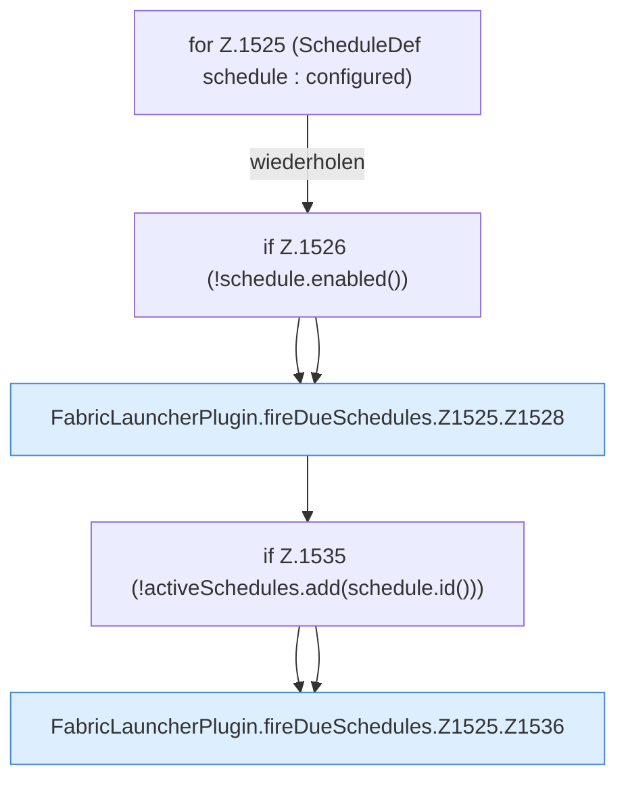

[[00 Start]] › [[Zeitplaene]] › [[Schedules]] › [[FabricLauncherPlugin.fireDueSchedules]] › [[FabricLauncherPlugin.fireDueSchedules.Z1525]]

# FabricLauncherPlugin.fireDueSchedules.Z1525



```knoten
for Z.1525 (ScheduleDef schedule : configured)
  Zeile 1525: Schleife `(ScheduleDef schedule : configured)`.
if Z.1526 (!schedule.enabled())
  Zeile 1526: prüft `(!schedule.enabled())`.
FabricLauncherPlugin.fireDueSchedules.Z1525.Z1528
  Fortsetzung des Ablaufs ab Zeile 1528.
if Z.1535 (!activeSchedules.add(schedule.id()))
  Zeile 1535: prüft `(!activeSchedules.add(schedule.id()))`.
FabricLauncherPlugin.fireDueSchedules.Z1525.Z1536
  Fortsetzung des Ablaufs ab Zeile 1536.
```

- Fortsetzung von `FabricLauncherPlugin.fireDueSchedules`, Quellreihenfolge.
