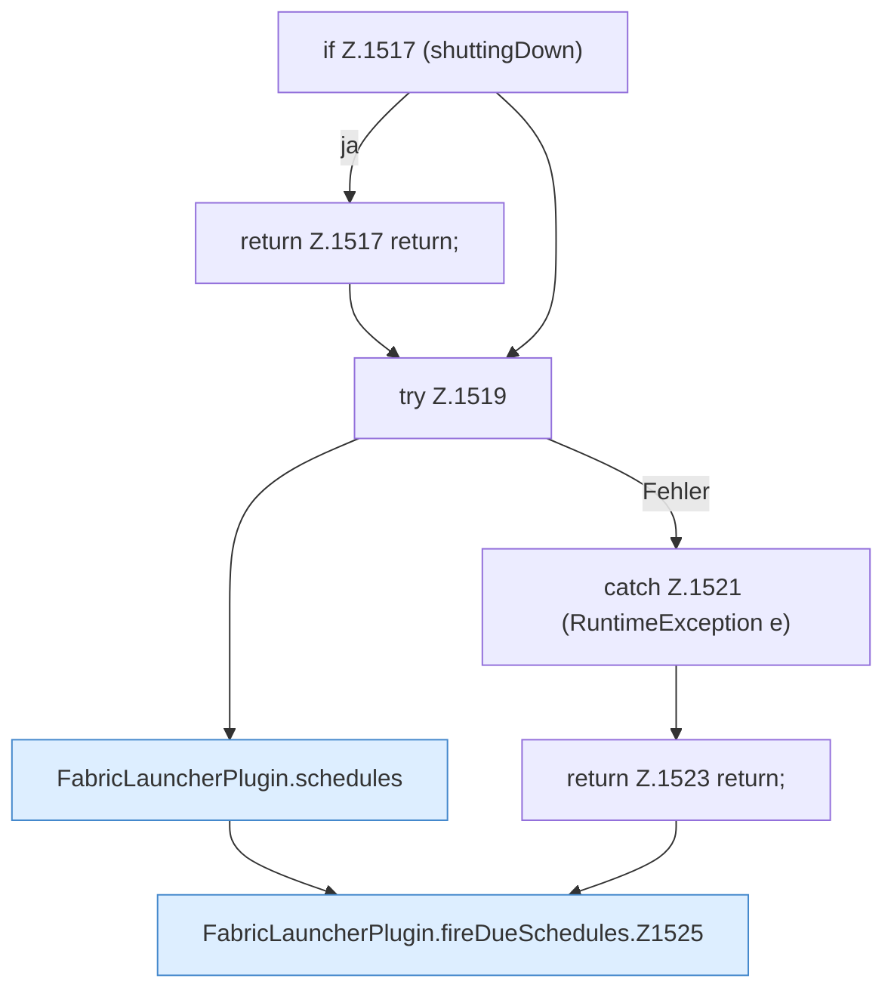

[[00 Start]] › [[Zeitplaene]] › [[Schedules]] › [[FabricLauncherPlugin.fireDueSchedules]]

# FabricLauncherPlugin.fireDueSchedules

`FabricLauncherPlugin.fireDueSchedules()` [src/main/java/de/aichele/childlauncher/FabricLauncherPlugin.java:1516–1545](https://github.com/Sciddie/minecraft-serverhoster-plugin/blob/95b02b953b0b4c23673e900e021a7c3c844aa37d/src/main/java/de/aichele/childlauncher/FabricLauncherPlugin.java#L1516-L1545)



```knoten
if Z.1517 (shuttingDown)
  Hier fällt eine Entscheidung. Nur wenn sie zutrifft, geht es den Ja-Weg weiter. Das steht in [[Glossar#Zeile|Zeile]] 1517.
return Z.1517 return;
  Hier endet die [[Glossar#Funktion|Funktion]] und liefert ein Ergebnis zurück. Das steht in [[Glossar#Zeile|Zeile]] 1517.
try Z.1519
  Das Programm versucht diesen Schritt. Geht er schief, führt der andere Weg weiter. Das steht in [[Glossar#Zeile|Zeile]] 1519.
FabricLauncherPlugin.schedules
  Das [[Glossar#Plugin|Plugin]] macht hier einen einzelnen Schritt. Eine Ebene tiefer steht er genauer. Im [[Glossar#Quelltext|Quelltext]] heißt das `schedules`.
catch Z.1521 (RuntimeException e)
  Dieser Weg gilt, wenn der Schritt davor schiefgegangen ist. Das steht in [[Glossar#Zeile|Zeile]] 1521.
return Z.1523 return;
  Hier endet die [[Glossar#Funktion|Funktion]] und liefert ein Ergebnis zurück. Das steht in [[Glossar#Zeile|Zeile]] 1523.
FabricLauncherPlugin.fireDueSchedules.Z1525
  Der Ablauf geht in [[Glossar#Zeile|Zeile]] 1525 weiter. Eine Ebene tiefer steht er genauer. Im [[Glossar#Quelltext|Quelltext]] heißt das `Z1525`.
```

> [!knoten]- Was die Blöcke tun
> - **if Z.1517 (shuttingDown)**: Hier fällt eine Entscheidung. Nur wenn sie zutrifft, geht es den Ja-Weg weiter. Das steht in [[Glossar#Zeile|Zeile]] 1517.
> - **return Z.1517 return;**: Hier endet die [[Glossar#Funktion|Funktion]] und liefert ein Ergebnis zurück. Das steht in [[Glossar#Zeile|Zeile]] 1517.
> - **try Z.1519**: Das Programm versucht diesen Schritt. Geht er schief, führt der andere Weg weiter. Das steht in [[Glossar#Zeile|Zeile]] 1519.
> - **FabricLauncherPlugin.schedules**: Das [[Glossar#Plugin|Plugin]] macht hier einen einzelnen Schritt. Eine Ebene tiefer steht er genauer. Im [[Glossar#Quelltext|Quelltext]] heißt das `schedules`.
> - **catch Z.1521 (RuntimeException e)**: Dieser Weg gilt, wenn der Schritt davor schiefgegangen ist. Das steht in [[Glossar#Zeile|Zeile]] 1521.
> - **return Z.1523 return;**: Hier endet die [[Glossar#Funktion|Funktion]] und liefert ein Ergebnis zurück. Das steht in [[Glossar#Zeile|Zeile]] 1523.
> - **FabricLauncherPlugin.fireDueSchedules.Z1525**: Der Ablauf geht in [[Glossar#Zeile|Zeile]] 1525 weiter. Eine Ebene tiefer steht er genauer. Im [[Glossar#Quelltext|Quelltext]] heißt das `Z1525`.

- Das [[Glossar#Plugin|Plugin]] stößt an Fälliges die Zeitpläne.
