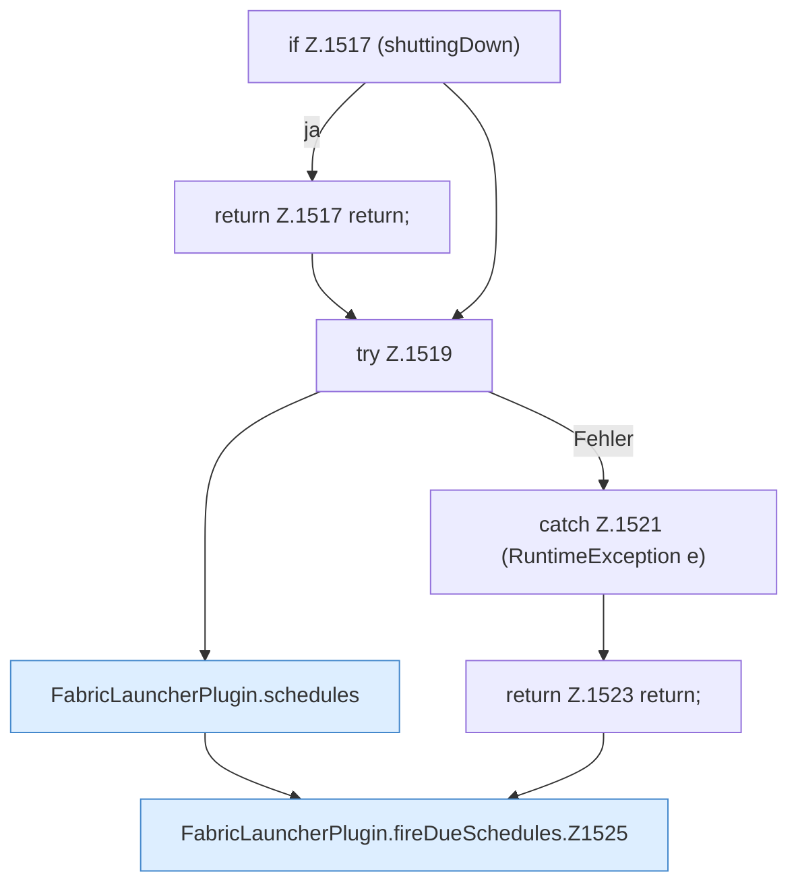

[[00 Start]] › [[Zeitplaene]] › [[Schedules]] › [[FabricLauncherPlugin.fireDueSchedules]]

# FabricLauncherPlugin.fireDueSchedules

`FabricLauncherPlugin.fireDueSchedules()` [src/main/java/de/aichele/childlauncher/FabricLauncherPlugin.java:1516–1545](https://github.com/Sciddie/minecraft-serverhoster-plugin/blob/95b02b953b0b4c23673e900e021a7c3c844aa37d/src/main/java/de/aichele/childlauncher/FabricLauncherPlugin.java#L1516-L1545)

- `fireDueSchedules` in `src/main/java/de/aichele/childlauncher/FabricLauncherPlugin.java`
