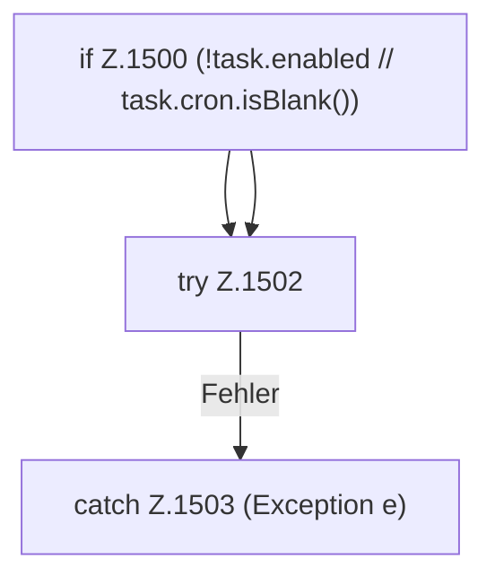

[[00 Start]] › [[Zeitplaene]] › [[Tasks]] › [[FabricLauncherPlugin.fireDueTasks]] › [[FabricLauncherPlugin.fireDueTasks.Z1499.Teil1]]

# FabricLauncherPlugin.fireDueTasks.Z1499.Teil1

- Fortsetzung von `FabricLauncherPlugin.fireDueTasks.Z1499`, Quellreihenfolge.
