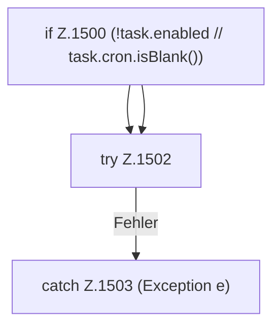

[[00 Start]] › [[Zeitplaene]] › [[Tasks]] › [[FabricLauncherPlugin.fireDueTasks]] › [[FabricLauncherPlugin.fireDueTasks.Z1499.Teil1]]

# FabricLauncherPlugin.fireDueTasks.Z1499.Teil1



```knoten
if Z.1500 (!task.enabled // task.cron.isBlank())
  Zeile 1500: prüft `(!task.enabled // task.cron.isBlank())`.
try Z.1502
  Zeile 1502: Versuch. Der Fehlerpfad geht in catch.
catch Z.1503 (Exception e)
  Zeile 1503: fängt (Exception e).
```

- Fortsetzung von `FabricLauncherPlugin.fireDueTasks.Z1499`, Quellreihenfolge.
