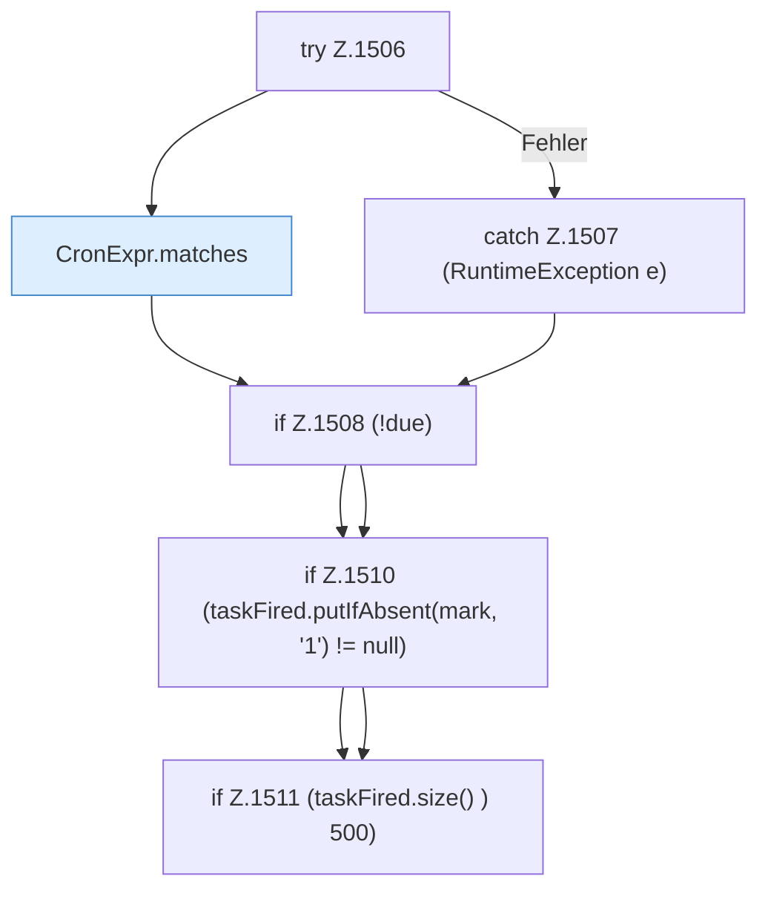

[[00 Start]] › [[Zeitplaene]] › [[Tasks]] › [[FabricLauncherPlugin.fireDueTasks]] › [[FabricLauncherPlugin.fireDueTasks.Z1499.Teil2]]

# FabricLauncherPlugin.fireDueTasks.Z1499.Teil2



```knoten
try Z.1506
  Zeile 1506: Versuch. Der Fehlerpfad geht in catch.
CronExpr.matches
  `matches` in `CronExpr.java`. Ruft `field`, `dow`.
catch Z.1507 (RuntimeException e)
  Zeile 1507: fängt (RuntimeException e).
if Z.1508 (!due)
  Zeile 1508: prüft `(!due)`.
if Z.1510 (taskFired.putIfAbsent(mark, '1') != null)
  Zeile 1510: prüft `(taskFired.putIfAbsent(mark, '1') != null)`.
if Z.1511 (taskFired.size() ) 500)
  Zeile 1511: prüft `(taskFired.size() ) 500)`.
```

- Fortsetzung von `FabricLauncherPlugin.fireDueTasks.Z1499`, Quellreihenfolge.
