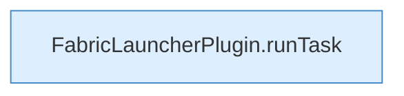

[[00 Start]] › [[Zeitplaene]] › [[Tasks]] › [[FabricLauncherPlugin.fireDueTasks]] › [[FabricLauncherPlugin.fireDueTasks.Z1499.Teil3]]

# FabricLauncherPlugin.fireDueTasks.Z1499.Teil3



```knoten
FabricLauncherPlugin.runTask
  Das [[Glossar#Plugin|Plugin]] führt aus die [[Glossar#Aufgabe|Aufgabe]]. Führt aus `runTask`. Ruft `executeTask`, `noteTask`, `notifyNtfy`.
```

> [!knoten]- Was die Blöcke tun
> - **FabricLauncherPlugin.runTask**: Das [[Glossar#Plugin|Plugin]] führt aus die [[Glossar#Aufgabe|Aufgabe]]. Führt aus `runTask`. Ruft `executeTask`, `noteTask`, `notifyNtfy`.

- Ein weiterer Abschnitt derselben Übersicht.
- Fortsetzung von `FabricLauncherPlugin.fireDueTasks.Z1499`.
