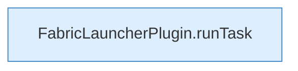

[[00 Start]] › [[Zeitplaene]] › [[Tasks]] › [[FabricLauncherPlugin.fireDueTasks]] › [[FabricLauncherPlugin.fireDueTasks.Z1499.Teil3]]

# FabricLauncherPlugin.fireDueTasks.Z1499.Teil3



```knoten
FabricLauncherPlugin.runTask
  Führt aus `runTask`. Ruft `executeTask`, `noteTask`, `notifyNtfy`.
```

- Fortsetzung von `FabricLauncherPlugin.fireDueTasks.Z1499`, Quellreihenfolge.
