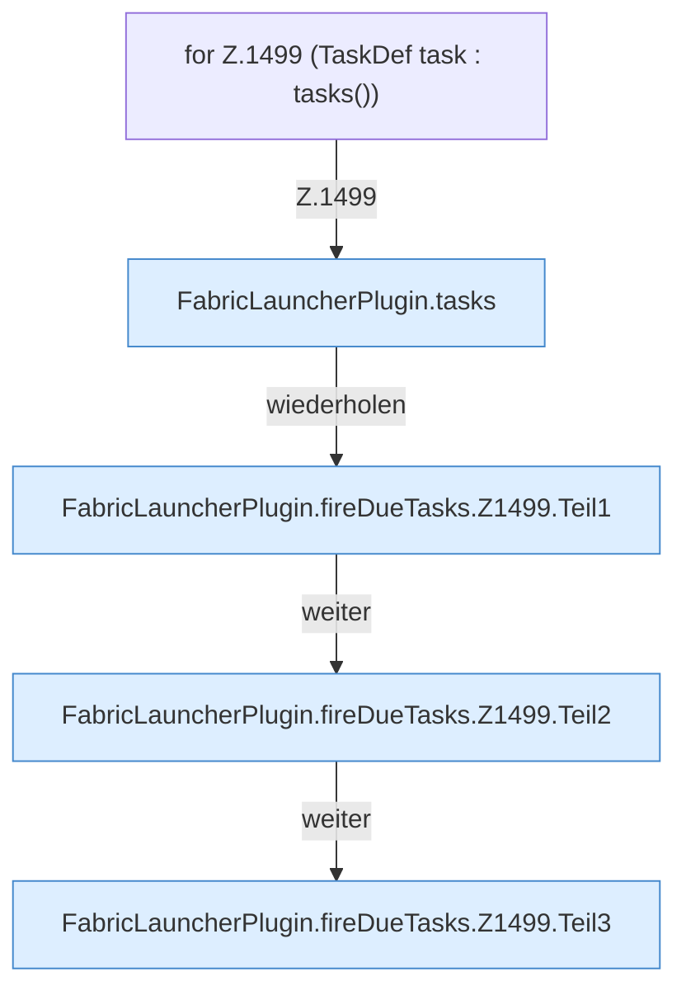

[[00 Start]] › [[Zeitplaene]] › [[Tasks]] › [[FabricLauncherPlugin.fireDueTasks]] › [[FabricLauncherPlugin.fireDueTasks.Z1499]]

# FabricLauncherPlugin.fireDueTasks.Z1499



```knoten
for Z.1499 (TaskDef task : tasks())
  Zeile 1499: Schleife `(TaskDef task : tasks())`.
FabricLauncherPlugin.tasks
  Das [[Glossar#Plugin|Plugin]] macht hier einen einzelnen Schritt. Eine Ebene tiefer steht er genauer. `tasks` in `FabricLauncherPlugin.java`. Ruft `load`.
FabricLauncherPlugin.fireDueTasks.Z1499.Teil1
  Ein weiterer Abschnitt derselben Übersicht. Abschnitt 1 dieses Ablaufs, in Quellreihenfolge.
FabricLauncherPlugin.fireDueTasks.Z1499.Teil2
  Ein weiterer Abschnitt derselben Übersicht. Abschnitt 2 dieses Ablaufs, in Quellreihenfolge.
FabricLauncherPlugin.fireDueTasks.Z1499.Teil3
  Ein weiterer Abschnitt derselben Übersicht. Abschnitt 3 dieses Ablaufs, in Quellreihenfolge.
```

> [!knoten]- Was die Blöcke tun
> - **for Z.1499 (TaskDef task : tasks())**: Zeile 1499: Schleife `(TaskDef task : tasks())`.
> - **FabricLauncherPlugin.tasks**: Das [[Glossar#Plugin|Plugin]] macht hier einen einzelnen Schritt. Eine Ebene tiefer steht er genauer. `tasks` in `FabricLauncherPlugin.java`. Ruft `load`.
> - **FabricLauncherPlugin.fireDueTasks.Z1499.Teil1**: Ein weiterer Abschnitt derselben Übersicht. Abschnitt 1 dieses Ablaufs, in Quellreihenfolge.
> - **FabricLauncherPlugin.fireDueTasks.Z1499.Teil2**: Ein weiterer Abschnitt derselben Übersicht. Abschnitt 2 dieses Ablaufs, in Quellreihenfolge.
> - **FabricLauncherPlugin.fireDueTasks.Z1499.Teil3**: Ein weiterer Abschnitt derselben Übersicht. Abschnitt 3 dieses Ablaufs, in Quellreihenfolge.

- Der Ablauf geht in [[Glossar#Zeile|Zeile]] 1499 weiter. Eine Ebene tiefer steht er genauer.
- Fortsetzung von `FabricLauncherPlugin.fireDueTasks`.
