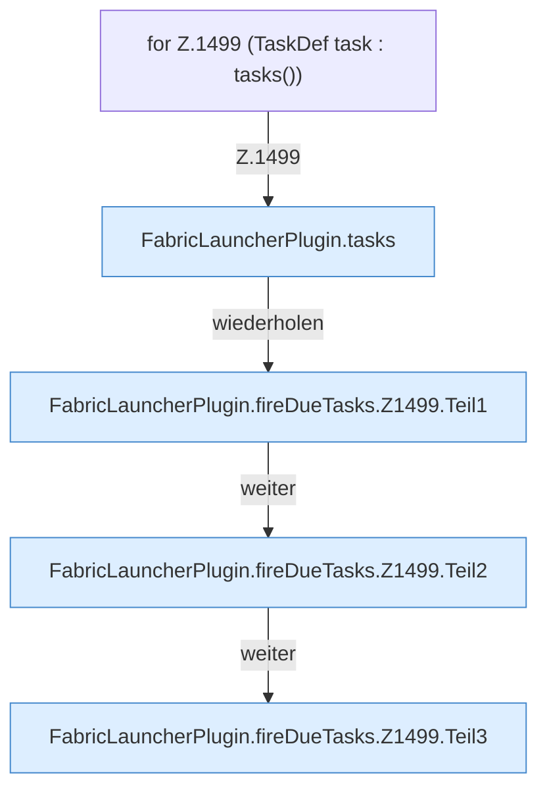

[[00 Start]] › [[Zeitplaene]] › [[Tasks]] › [[FabricLauncherPlugin.fireDueTasks]] › [[FabricLauncherPlugin.fireDueTasks.Z1499]]

# FabricLauncherPlugin.fireDueTasks.Z1499

- Fortsetzung von `FabricLauncherPlugin.fireDueTasks`, Quellreihenfolge.
