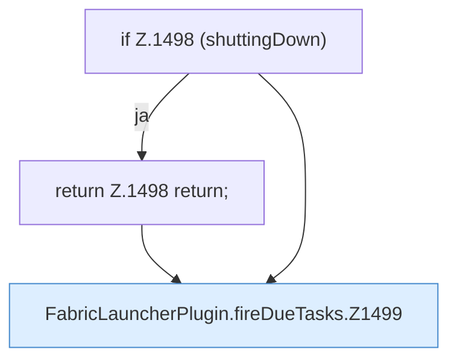

[[00 Start]] › [[Zeitplaene]] › [[Tasks]] › [[FabricLauncherPlugin.fireDueTasks]]

# FabricLauncherPlugin.fireDueTasks

`FabricLauncherPlugin.fireDueTasks()` [src/main/java/de/aichele/childlauncher/FabricLauncherPlugin.java:1497–1514](https://github.com/Sciddie/minecraft-serverhoster-plugin/blob/95b02b953b0b4c23673e900e021a7c3c844aa37d/src/main/java/de/aichele/childlauncher/FabricLauncherPlugin.java#L1497-L1514)



```knoten
if Z.1498 (shuttingDown)
  Zeile 1498: prüft `(shuttingDown)`.
return Z.1498 return;
  Zeile 1498: Rückgabe `return;`.
FabricLauncherPlugin.fireDueTasks.Z1499
  Fortsetzung des Ablaufs ab Zeile 1499.
```

- `fireDueTasks` in `src/main/java/de/aichele/childlauncher/FabricLauncherPlugin.java`
- Befund: Altlast, sicher. FabricLauncherPlugin.java:151 und config.yml:93 Kommentar Deprecated
