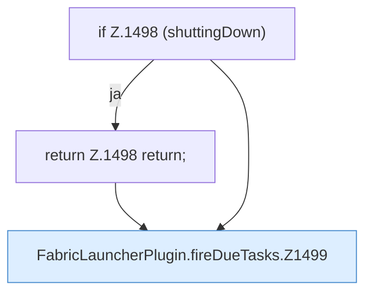

[[00 Start]] › [[Zeitplaene]] › [[Tasks]] › [[FabricLauncherPlugin.fireDueTasks]]

# FabricLauncherPlugin.fireDueTasks

`FabricLauncherPlugin.fireDueTasks()` [src/main/java/de/aichele/childlauncher/FabricLauncherPlugin.java:1497–1514](https://github.com/Sciddie/minecraft-serverhoster-plugin/blob/95b02b953b0b4c23673e900e021a7c3c844aa37d/src/main/java/de/aichele/childlauncher/FabricLauncherPlugin.java#L1497-L1514)



```knoten
if Z.1498 (shuttingDown)
  Hier fällt eine Entscheidung. Nur wenn sie zutrifft, geht es den Ja-Weg weiter. Das steht in [[Glossar#Zeile|Zeile]] 1498.
return Z.1498 return;
  Hier endet die [[Glossar#Funktion|Funktion]] und liefert ein Ergebnis zurück. Das steht in [[Glossar#Zeile|Zeile]] 1498.
FabricLauncherPlugin.fireDueTasks.Z1499
  Der Ablauf geht in [[Glossar#Zeile|Zeile]] 1499 weiter. Eine Ebene tiefer steht er genauer. Im [[Glossar#Quelltext|Quelltext]] heißt das `Z1499`.
```

> [!knoten]- Was die Blöcke tun
> - **if Z.1498 (shuttingDown)**: Hier fällt eine Entscheidung. Nur wenn sie zutrifft, geht es den Ja-Weg weiter. Das steht in [[Glossar#Zeile|Zeile]] 1498.
> - **return Z.1498 return;**: Hier endet die [[Glossar#Funktion|Funktion]] und liefert ein Ergebnis zurück. Das steht in [[Glossar#Zeile|Zeile]] 1498.
> - **FabricLauncherPlugin.fireDueTasks.Z1499**: Der Ablauf geht in [[Glossar#Zeile|Zeile]] 1499 weiter. Eine Ebene tiefer steht er genauer. Im [[Glossar#Quelltext|Quelltext]] heißt das `Z1499`.

- Das [[Glossar#Plugin|Plugin]] stößt an Fälliges die [[Glossar#Aufgabe|Aufgaben]].
- Auffällig: ein alter Weg läuft noch mit. Das nennt man [[Glossar#Altlast|Altlast]].
