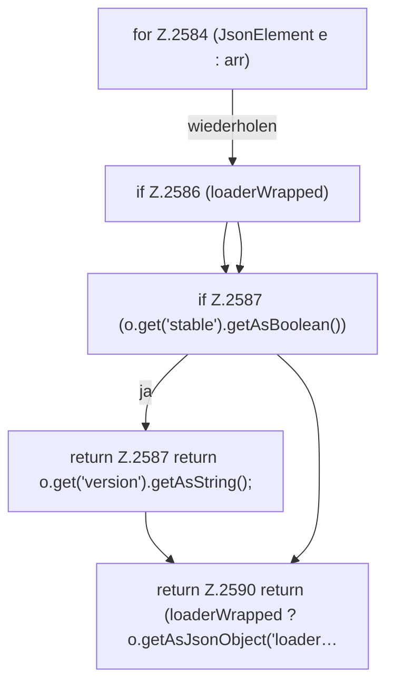

[[00 Start]] › [[Server-Anlage]] › [[Versionen]] › [[FabricLauncherPlugin.firstStable]]

# FabricLauncherPlugin.firstStable

`FabricLauncherPlugin.firstStable(JsonArray arr, boolean loaderWrapped)` [src/main/java/de/aichele/childlauncher/FabricLauncherPlugin.java:2583–2591](https://github.com/Sciddie/minecraft-serverhoster-plugin/blob/95b02b953b0b4c23673e900e021a7c3c844aa37d/src/main/java/de/aichele/childlauncher/FabricLauncherPlugin.java#L2583-L2591)

- `firstStable` in `src/main/java/de/aichele/childlauncher/FabricLauncherPlugin.java`
