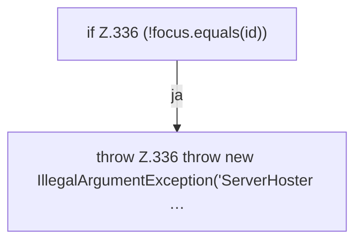

[[00 Start]] › [[Plugin-Kern]] › [[Fokus]] › [[FabricLauncherPlugin.focus]]

# FabricLauncherPlugin.focus

`FabricLauncherPlugin.focus(String id)` [src/main/java/de/aichele/childlauncher/FabricLauncherPlugin.java:335–337](https://github.com/Sciddie/minecraft-serverhoster-plugin/blob/95b02b953b0b4c23673e900e021a7c3c844aa37d/src/main/java/de/aichele/childlauncher/FabricLauncherPlugin.java#L335-L337)



```knoten
if Z.336 (!focus.equals(id))
  Hier fällt eine Entscheidung. Nur wenn sie zutrifft, geht es den Ja-Weg weiter. Das steht in [[Glossar#Zeile|Zeile]] 336.
throw Z.336 throw new IllegalArgumentException('ServerHoster …
  Hier bricht die [[Glossar#Funktion|Funktion]] ab, weil etwas nicht geklappt hat. Das steht in [[Glossar#Zeile|Zeile]] 336.
```

> [!knoten]- Was die Blöcke tun
> - **if Z.336 (!focus.equals(id))**: Hier fällt eine Entscheidung. Nur wenn sie zutrifft, geht es den Ja-Weg weiter. Das steht in [[Glossar#Zeile|Zeile]] 336.
> - **throw Z.336 throw new IllegalArgumentException('ServerHoster …**: Hier bricht die [[Glossar#Funktion|Funktion]] ab, weil etwas nicht geklappt hat. Das steht in [[Glossar#Zeile|Zeile]] 336.

- Liefert den Server, der gerade gemeint ist.
- Auffällig: im normalen Betrieb ruft das niemand auf. Das nennt man [[Glossar#Ungenutzt|Ungenutzt]].
