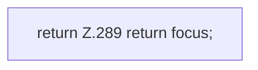

[[00 Start]] › [[Plugin-Kern]] › [[Fokus]] › [[FabricLauncherPlugin.focusId]]

# FabricLauncherPlugin.focusId

`FabricLauncherPlugin.focusId()` [src/main/java/de/aichele/childlauncher/FabricLauncherPlugin.java:289–289](https://github.com/Sciddie/minecraft-serverhoster-plugin/blob/95b02b953b0b4c23673e900e021a7c3c844aa37d/src/main/java/de/aichele/childlauncher/FabricLauncherPlugin.java#L289-L289)



```knoten
return Z.289 return focus;
  Hier endet die [[Glossar#Funktion|Funktion]] und liefert ein Ergebnis zurück. Das steht in [[Glossar#Zeile|Zeile]] 289.
```

> [!knoten]- Was die Blöcke tun
> - **return Z.289 return focus;**: Hier endet die [[Glossar#Funktion|Funktion]] und liefert ein Ergebnis zurück. Das steht in [[Glossar#Zeile|Zeile]] 289.

- Das [[Glossar#Plugin|Plugin]] liefert die Kennung.
