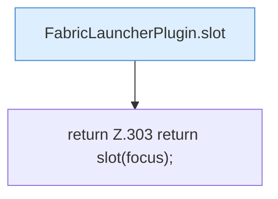

[[00 Start]] › [[Plugin-Kern]] › [[Fokus]] › [[FabricLauncherPlugin.focusSlot]]

# FabricLauncherPlugin.focusSlot

`FabricLauncherPlugin.focusSlot()` [src/main/java/de/aichele/childlauncher/FabricLauncherPlugin.java:303–303](https://github.com/Sciddie/minecraft-serverhoster-plugin/blob/95b02b953b0b4c23673e900e021a7c3c844aa37d/src/main/java/de/aichele/childlauncher/FabricLauncherPlugin.java#L303-L303)

- `focusSlot` in `src/main/java/de/aichele/childlauncher/FabricLauncherPlugin.java`
