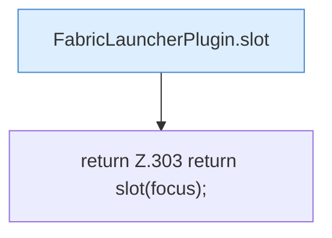

[[00 Start]] › [[Plugin-Kern]] › [[Fokus]] › [[FabricLauncherPlugin.focusSlot]]

# FabricLauncherPlugin.focusSlot

`FabricLauncherPlugin.focusSlot()` [src/main/java/de/aichele/childlauncher/FabricLauncherPlugin.java:303–303](https://github.com/Sciddie/minecraft-serverhoster-plugin/blob/95b02b953b0b4c23673e900e021a7c3c844aa37d/src/main/java/de/aichele/childlauncher/FabricLauncherPlugin.java#L303-L303)



```knoten
FabricLauncherPlugin.slot
  Das [[Glossar#Plugin|Plugin]] macht hier einen einzelnen Schritt. Eine Ebene tiefer steht er genauer. Im [[Glossar#Quelltext|Quelltext]] heißt das `slot`.
return Z.303 return slot(focus);
  Hier endet die [[Glossar#Funktion|Funktion]] und liefert ein Ergebnis zurück. Das steht in [[Glossar#Zeile|Zeile]] 303.
```

> [!knoten]- Was die Blöcke tun
> - **FabricLauncherPlugin.slot**: Das [[Glossar#Plugin|Plugin]] macht hier einen einzelnen Schritt. Eine Ebene tiefer steht er genauer. Im [[Glossar#Quelltext|Quelltext]] heißt das `slot`.
> - **return Z.303 return slot(focus);**: Hier endet die [[Glossar#Funktion|Funktion]] und liefert ein Ergebnis zurück. Das steht in [[Glossar#Zeile|Zeile]] 303.

- Das [[Glossar#Plugin|Plugin]] liefert den [[Glossar#Platz|Platz]].
