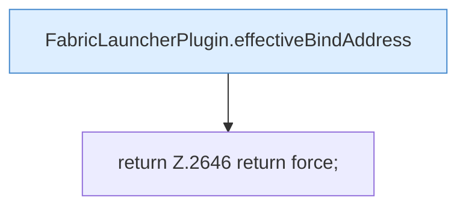

[[00 Start]] › [[Plugin-Kern]] › [[Properties]] › [[FabricLauncherPlugin.forcedProperties]]

# FabricLauncherPlugin.forcedProperties

`FabricLauncherPlugin.forcedProperties(ServerProfile profile, String hostAddress)` [src/main/java/de/aichele/childlauncher/FabricLauncherPlugin.java:2641–2647](https://github.com/Sciddie/minecraft-serverhoster-plugin/blob/95b02b953b0b4c23673e900e021a7c3c844aa37d/src/main/java/de/aichele/childlauncher/FabricLauncherPlugin.java#L2641-L2647)

- `forcedProperties` in `src/main/java/de/aichele/childlauncher/FabricLauncherPlugin.java`
