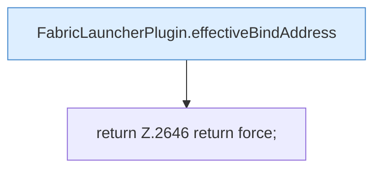

[[00 Start]] › [[Plugin-Kern]] › [[Properties]] › [[FabricLauncherPlugin.forcedProperties]]

# FabricLauncherPlugin.forcedProperties

`FabricLauncherPlugin.forcedProperties(ServerProfile profile, String hostAddress)` [src/main/java/de/aichele/childlauncher/FabricLauncherPlugin.java:2641–2647](https://github.com/Sciddie/minecraft-serverhoster-plugin/blob/95b02b953b0b4c23673e900e021a7c3c844aa37d/src/main/java/de/aichele/childlauncher/FabricLauncherPlugin.java#L2641-L2647)



```knoten
FabricLauncherPlugin.effectiveBindAddress
  Die Adresse, die nach allen Ersatzregeln wirklich gilt. Im [[Glossar#Quelltext|Quelltext]] heißt das `effectiveBindAddress`.
return Z.2646 return force;
  Hier endet die [[Glossar#Funktion|Funktion]] und liefert ein Ergebnis zurück. Das steht in [[Glossar#Zeile|Zeile]] 2646.
```

> [!knoten]- Was die Blöcke tun
> - **FabricLauncherPlugin.effectiveBindAddress**: Die Adresse, die nach allen Ersatzregeln wirklich gilt. Im [[Glossar#Quelltext|Quelltext]] heißt das `effectiveBindAddress`.
> - **return Z.2646 return force;**: Hier endet die [[Glossar#Funktion|Funktion]] und liefert ein Ergebnis zurück. Das steht in [[Glossar#Zeile|Zeile]] 2646.

- Werte, die das [[Glossar#Plugin|Plugin]] in der Eigenschaftsdatei fest setzt, auch wenn dort etwas anderes steht.
