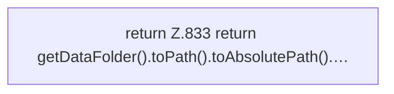

[[00 Start]] › [[Plugin-Kern]] › [[Host-Pfade]] › [[FabricLauncherPlugin.getWorldRoot]]

# FabricLauncherPlugin.getWorldRoot

`FabricLauncherPlugin.getWorldRoot()` [src/main/java/de/aichele/childlauncher/FabricLauncherPlugin.java:832–834](https://github.com/Sciddie/minecraft-serverhoster-plugin/blob/95b02b953b0b4c23673e900e021a7c3c844aa37d/src/main/java/de/aichele/childlauncher/FabricLauncherPlugin.java#L832-L834)



```knoten
return Z.833 return getDataFolder().toPath().toAbsolutePath().…
  Hier endet die [[Glossar#Funktion|Funktion]] und liefert ein Ergebnis zurück. Das steht in [[Glossar#Zeile|Zeile]] 833.
```

> [!knoten]- Was die Blöcke tun
> - **return Z.833 return getDataFolder().toPath().toAbsolutePath().…**: Hier endet die [[Glossar#Funktion|Funktion]] und liefert ein Ergebnis zurück. Das steht in [[Glossar#Zeile|Zeile]] 833.

- Das [[Glossar#Plugin|Plugin]] liefert die [[Glossar#Spielwelt|Spielwelt]] den Anfang.
