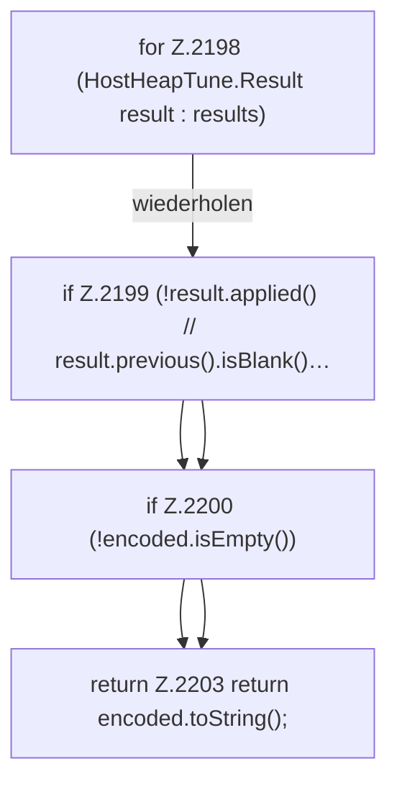

[[00 Start]] › [[Host-Betrieb]] › [[Host-Minimieren]] › [[Host-Minimieren.Teil1]] › [[FabricLauncherPlugin.heapPrevious]]

# FabricLauncherPlugin.heapPrevious

`FabricLauncherPlugin.heapPrevious(List<HostHeapTune.Result> results)` [src/main/java/de/aichele/childlauncher/FabricLauncherPlugin.java:2196–2204](https://github.com/Sciddie/minecraft-serverhoster-plugin/blob/95b02b953b0b4c23673e900e021a7c3c844aa37d/src/main/java/de/aichele/childlauncher/FabricLauncherPlugin.java#L2196-L2204)

- `heapPrevious` in `src/main/java/de/aichele/childlauncher/FabricLauncherPlugin.java`
