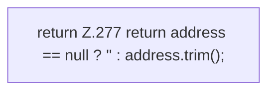

[[00 Start]] › [[Plugin-Kern]] › [[Bind-Adresse]] › [[FabricLauncherPlugin.hostBindAddress]]

# FabricLauncherPlugin.hostBindAddress

`FabricLauncherPlugin.hostBindAddress()` [src/main/java/de/aichele/childlauncher/FabricLauncherPlugin.java:275–278](https://github.com/Sciddie/minecraft-serverhoster-plugin/blob/95b02b953b0b4c23673e900e021a7c3c844aa37d/src/main/java/de/aichele/childlauncher/FabricLauncherPlugin.java#L275-L278)



```knoten
return Z.277 return address == null ? '' : address.trim();
  Hier endet die [[Glossar#Funktion|Funktion]] und liefert ein Ergebnis zurück. Das steht in [[Glossar#Zeile|Zeile]] 277.
```

> [!knoten]- Was die Blöcke tun
> - **return Z.277 return address == null ? '' : address.trim();**: Hier endet die [[Glossar#Funktion|Funktion]] und liefert ein Ergebnis zurück. Das steht in [[Glossar#Zeile|Zeile]] 277.

- Die Adresse, unter der der [[Glossar#Host|Host]] selbst erreichbar sein soll.
