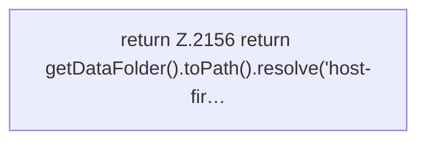

[[00 Start]] › [[Host-Betrieb]] › [[Host-Ersteinrichtung]] › [[FabricLauncherPlugin.hostFirstSetupMarker]]

# FabricLauncherPlugin.hostFirstSetupMarker

`FabricLauncherPlugin.hostFirstSetupMarker()` [src/main/java/de/aichele/childlauncher/FabricLauncherPlugin.java:2155–2157](https://github.com/Sciddie/minecraft-serverhoster-plugin/blob/95b02b953b0b4c23673e900e021a7c3c844aa37d/src/main/java/de/aichele/childlauncher/FabricLauncherPlugin.java#L2155-L2157)



```knoten
return Z.2156 return getDataFolder().toPath().resolve('host-fir…
  Zeile 2156: Rückgabe `return getDataFolder().toPath().resolve('host-fir…`.
```

- `hostFirstSetupMarker` in `src/main/java/de/aichele/childlauncher/FabricLauncherPlugin.java`
