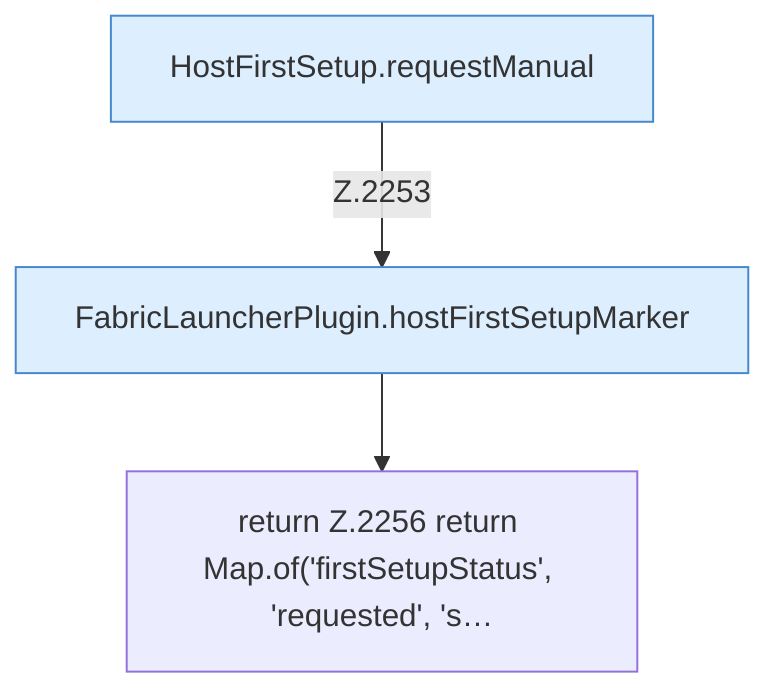

[[00 Start]] › [[Host-Betrieb]] › [[Host-Ersteinrichtung]] › [[FabricLauncherPlugin.hostFirstSetupRequest]]

# FabricLauncherPlugin.hostFirstSetupRequest

`FabricLauncherPlugin.hostFirstSetupRequest(String confirm)` [src/main/java/de/aichele/childlauncher/FabricLauncherPlugin.java:2252–2257](https://github.com/Sciddie/minecraft-serverhoster-plugin/blob/95b02b953b0b4c23673e900e021a7c3c844aa37d/src/main/java/de/aichele/childlauncher/FabricLauncherPlugin.java#L2252-L2257)



```knoten
HostFirstSetup.requestManual
  Die [[Glossar#Ersteinrichtung|Ersteinrichtung]] fordert an die Handarbeit. Im [[Glossar#Quelltext|Quelltext]] heißt das `requestManual`.
FabricLauncherPlugin.hostFirstSetupMarker
  Liest oder schreibt die Merkdatei der [[Glossar#Ersteinrichtung|Ersteinrichtung]]. Im [[Glossar#Quelltext|Quelltext]] heißt das `hostFirstSetupMarker`.
return Z.2256 return Map.of('firstSetupStatus', 'requested', 's…
  Hier endet die [[Glossar#Funktion|Funktion]] und liefert ein Ergebnis zurück. Das steht in [[Glossar#Zeile|Zeile]] 2256.
```

> [!knoten]- Was die Blöcke tun
> - **HostFirstSetup.requestManual**: Die [[Glossar#Ersteinrichtung|Ersteinrichtung]] fordert an die Handarbeit. Im [[Glossar#Quelltext|Quelltext]] heißt das `requestManual`.
> - **FabricLauncherPlugin.hostFirstSetupMarker**: Liest oder schreibt die Merkdatei der [[Glossar#Ersteinrichtung|Ersteinrichtung]]. Im [[Glossar#Quelltext|Quelltext]] heißt das `hostFirstSetupMarker`.
> - **return Z.2256 return Map.of('firstSetupStatus', 'requested', 's…**: Hier endet die [[Glossar#Funktion|Funktion]] und liefert ein Ergebnis zurück. Das steht in [[Glossar#Zeile|Zeile]] 2256.

- Merkt den Wunsch, die [[Glossar#Ersteinrichtung|Ersteinrichtung]] von Hand anzustoßen.
