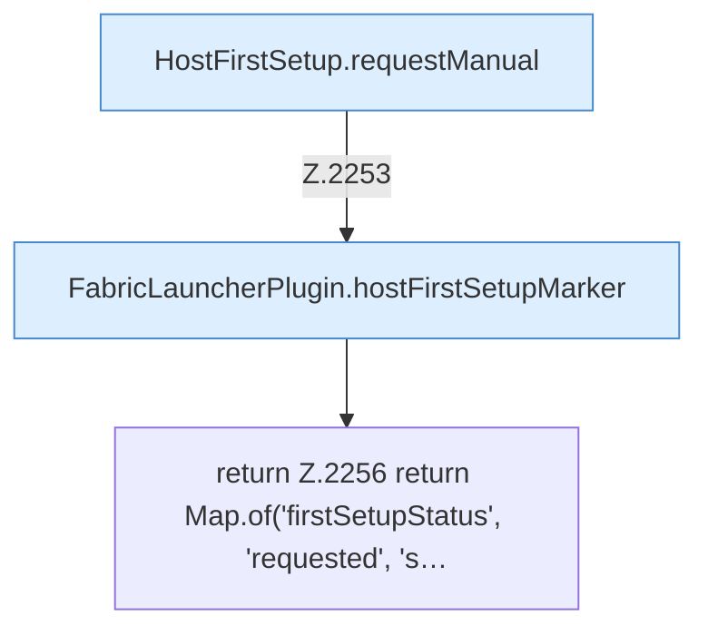

[[00 Start]] › [[Host-Betrieb]] › [[Host-Ersteinrichtung]] › [[FabricLauncherPlugin.hostFirstSetupRequest]]

# FabricLauncherPlugin.hostFirstSetupRequest

`FabricLauncherPlugin.hostFirstSetupRequest(String confirm)` [src/main/java/de/aichele/childlauncher/FabricLauncherPlugin.java:2252–2257](https://github.com/Sciddie/minecraft-serverhoster-plugin/blob/95b02b953b0b4c23673e900e021a7c3c844aa37d/src/main/java/de/aichele/childlauncher/FabricLauncherPlugin.java#L2252-L2257)



```knoten
HostFirstSetup.requestManual
  Fordert an `requestManual`. Ruft `readState`, `writeMarker`.
FabricLauncherPlugin.hostFirstSetupMarker
  Betrifft den Host `hostFirstSetupMarker`.
return Z.2256 return Map.of('firstSetupStatus', 'requested', 's…
  Zeile 2256: Rückgabe `return Map.of('firstSetupStatus', 'requested', 's…`.
```

- `hostFirstSetupRequest` in `src/main/java/de/aichele/childlauncher/FabricLauncherPlugin.java`
