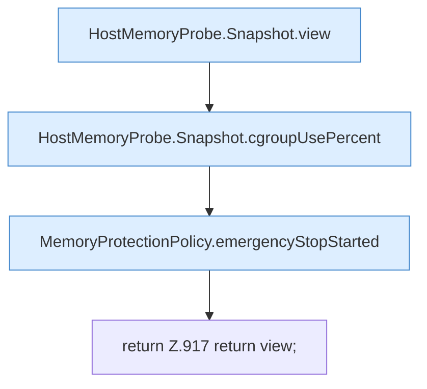

[[00 Start]] › [[Host-Betrieb]] › [[Speicher-Probe]] › [[FabricLauncherPlugin.hostMemoryView]]

# FabricLauncherPlugin.hostMemoryView

`FabricLauncherPlugin.hostMemoryView()` [src/main/java/de/aichele/childlauncher/FabricLauncherPlugin.java:911–918](https://github.com/Sciddie/minecraft-serverhoster-plugin/blob/95b02b953b0b4c23673e900e021a7c3c844aa37d/src/main/java/de/aichele/childlauncher/FabricLauncherPlugin.java#L911-L918)



```knoten
HostMemoryProbe.Snapshot.view
  Die Messung macht hier einen einzelnen Schritt. Eine Ebene tiefer steht er genauer. Im [[Glossar#Quelltext|Quelltext]] heißt das `view`.
HostMemoryProbe.Snapshot.cgroupUsePercent
  Die Messung macht hier einen einzelnen Schritt. Eine Ebene tiefer steht er genauer. Im [[Glossar#Quelltext|Quelltext]] heißt das `cgroupUsePercent`.
MemoryProtectionPolicy.emergencyStopStarted
  Dieser Teil stoppt hier einen Schritt. Eine Ebene tiefer steht er genauer. Im [[Glossar#Quelltext|Quelltext]] heißt das `emergencyStopStarted`.
return Z.917 return view;
  Hier endet die [[Glossar#Funktion|Funktion]] und liefert ein Ergebnis zurück. Das steht in [[Glossar#Zeile|Zeile]] 917.
```

> [!knoten]- Was die Blöcke tun
> - **HostMemoryProbe.Snapshot.view**: Die Messung macht hier einen einzelnen Schritt. Eine Ebene tiefer steht er genauer. Im [[Glossar#Quelltext|Quelltext]] heißt das `view`.
> - **HostMemoryProbe.Snapshot.cgroupUsePercent**: Die Messung macht hier einen einzelnen Schritt. Eine Ebene tiefer steht er genauer. Im [[Glossar#Quelltext|Quelltext]] heißt das `cgroupUsePercent`.
> - **MemoryProtectionPolicy.emergencyStopStarted**: Dieser Teil stoppt hier einen Schritt. Eine Ebene tiefer steht er genauer. Im [[Glossar#Quelltext|Quelltext]] heißt das `emergencyStopStarted`.
> - **return Z.917 return view;**: Hier endet die [[Glossar#Funktion|Funktion]] und liefert ein Ergebnis zurück. Das steht in [[Glossar#Zeile|Zeile]] 917.

- Stellt die Speichermessung so zusammen, wie die [[Glossar#Bedienseite|Bedienseite]] sie zeigt.
