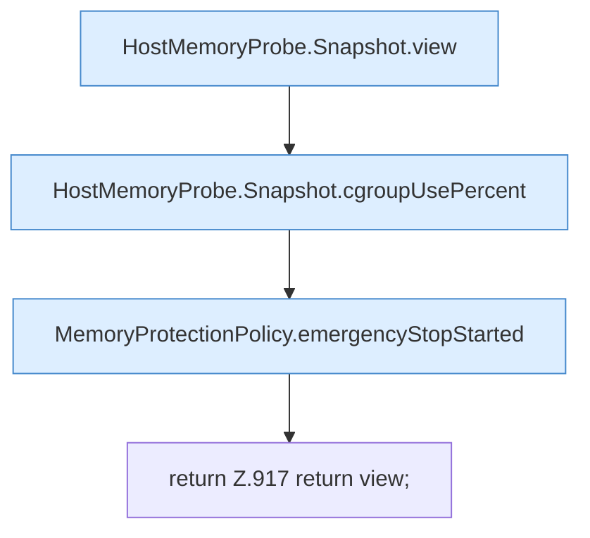

[[00 Start]] › [[Host-Betrieb]] › [[Speicher-Probe]] › [[FabricLauncherPlugin.hostMemoryView]]

# FabricLauncherPlugin.hostMemoryView

`FabricLauncherPlugin.hostMemoryView()` [src/main/java/de/aichele/childlauncher/FabricLauncherPlugin.java:911–918](https://github.com/Sciddie/minecraft-serverhoster-plugin/blob/95b02b953b0b4c23673e900e021a7c3c844aa37d/src/main/java/de/aichele/childlauncher/FabricLauncherPlugin.java#L911-L918)

- `hostMemoryView` in `src/main/java/de/aichele/childlauncher/FabricLauncherPlugin.java`
