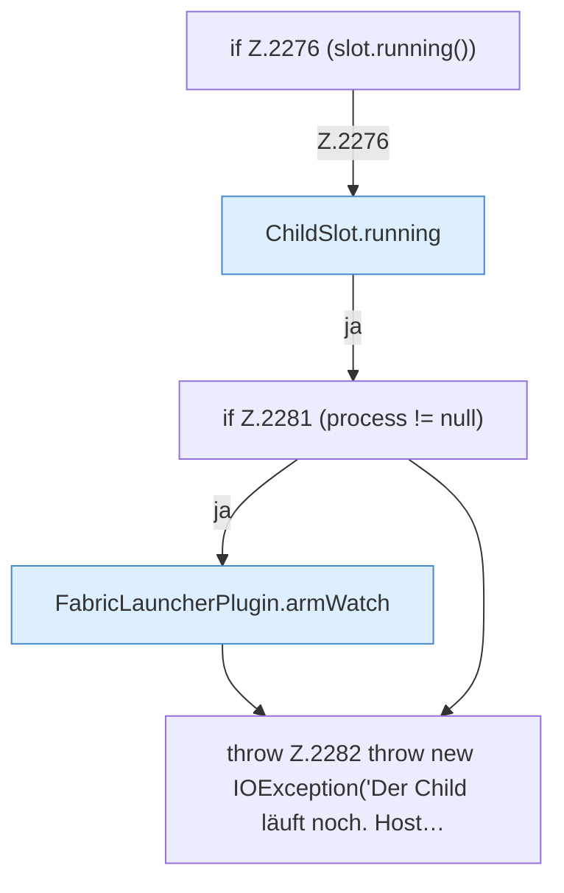

[[00 Start]] › [[Host-Betrieb]] › [[Host-Minimieren]] › [[Host-Minimieren.Teil1]] › [[FabricLauncherPlugin.hostMinimizeApply]] › [[FabricLauncherPlugin.hostMinimizeApply.Teil1.Z2274.Z2276]]

# FabricLauncherPlugin.hostMinimizeApply.Teil1.Z2274.Z2276



```knoten
if Z.2276 (slot.running())
  Zeile 2276: prüft `(slot.running())`.
ChildSlot.running
  Sagt, ob der Prozess läuft `running`.
if Z.2281 (process != null)
  Zeile 2281: prüft `(process != null)`.
FabricLauncherPlugin.armWatch
  Hängt die Überwachung an `armWatch`. Ruft `watch`.
throw Z.2282 throw new IOException('Der Child läuft noch. Host…
  Zeile 2282: Abbruch `throw new IOException('Der Child läuft noch. Host…`.
```

- Fortsetzung von `FabricLauncherPlugin.hostMinimizeApply.Teil1.Z2274`, Quellreihenfolge.
