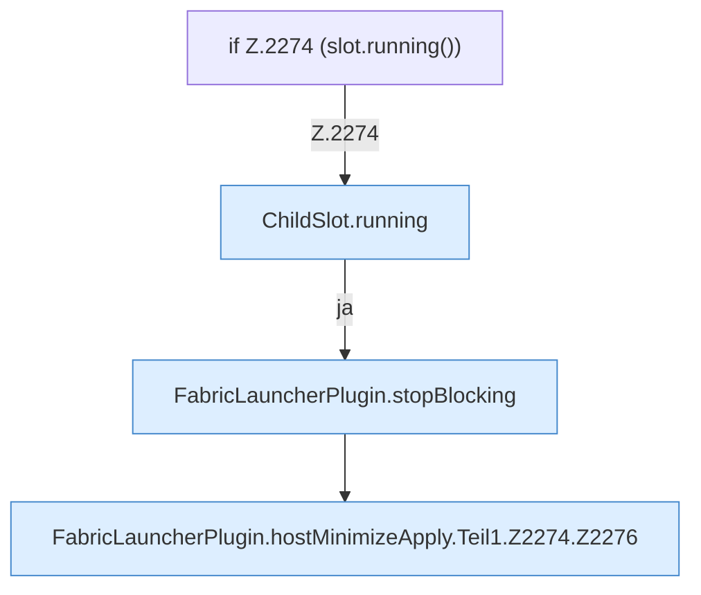

[[00 Start]] › [[Host-Betrieb]] › [[Host-Minimieren]] › [[Host-Minimieren.Teil1]] › [[FabricLauncherPlugin.hostMinimizeApply]] › [[FabricLauncherPlugin.hostMinimizeApply.Teil1.Z2274]]

# FabricLauncherPlugin.hostMinimizeApply.Teil1.Z2274



```knoten
if Z.2274 (slot.running())
  Zeile 2274: prüft `(slot.running())`.
ChildSlot.running
  Dieser Teil prüft, ob läuft, das. Sagt, ob der [[Glossar#Prozess|Prozess]] läuft `running`.
FabricLauncherPlugin.stopBlocking
  Setzt den Zustand auf „stoppt“ und wartet, bis der [[Glossar#Spielserver|Spielserver]] wirklich aus ist. Stoppt `stopBlocking`. Ruft `invalidateRestarts`, `running`, `stopProcess`.
FabricLauncherPlugin.hostMinimizeApply.Teil1.Z2274.Z2276
  Der Ablauf geht in [[Glossar#Zeile|Zeile]] 2276 weiter. Eine Ebene tiefer steht er genauer. Fortsetzung des Ablaufs ab Zeile 2276.
```

> [!knoten]- Was die Blöcke tun
> - **if Z.2274 (slot.running())**: Zeile 2274: prüft `(slot.running())`.
> - **ChildSlot.running**: Dieser Teil prüft, ob läuft, das. Sagt, ob der [[Glossar#Prozess|Prozess]] läuft `running`.
> - **FabricLauncherPlugin.stopBlocking**: Setzt den Zustand auf „stoppt“ und wartet, bis der [[Glossar#Spielserver|Spielserver]] wirklich aus ist. Stoppt `stopBlocking`. Ruft `invalidateRestarts`, `running`, `stopProcess`.
> - **FabricLauncherPlugin.hostMinimizeApply.Teil1.Z2274.Z2276**: Der Ablauf geht in [[Glossar#Zeile|Zeile]] 2276 weiter. Eine Ebene tiefer steht er genauer. Fortsetzung des Ablaufs ab Zeile 2276.

- Der Ablauf geht in [[Glossar#Zeile|Zeile]] 2274 weiter. Eine Ebene tiefer steht er genauer.
- Fortsetzung von `FabricLauncherPlugin.hostMinimizeApply.Teil1`.
