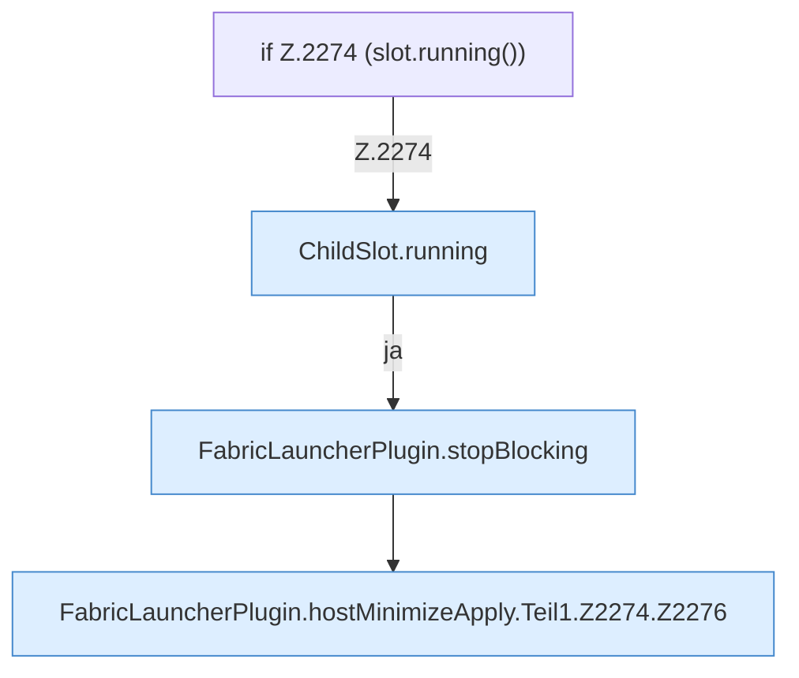

[[00 Start]] › [[Host-Betrieb]] › [[Host-Minimieren]] › [[Host-Minimieren.Teil1]] › [[FabricLauncherPlugin.hostMinimizeApply]] › [[FabricLauncherPlugin.hostMinimizeApply.Teil1.Z2274]]

# FabricLauncherPlugin.hostMinimizeApply.Teil1.Z2274

- Fortsetzung von `FabricLauncherPlugin.hostMinimizeApply.Teil1`, Quellreihenfolge.
