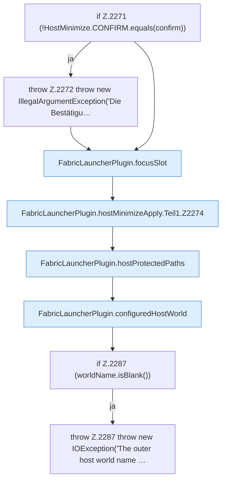

[[00 Start]] › [[Host-Betrieb]] › [[Host-Minimieren]] › [[Host-Minimieren.Teil1]] › [[FabricLauncherPlugin.hostMinimizeApply]] › [[FabricLauncherPlugin.hostMinimizeApply.Teil1]]

# FabricLauncherPlugin.hostMinimizeApply.Teil1



```knoten
if Z.2271 (!HostMinimize.CONFIRM.equals(confirm))
  Zeile 2271: prüft `(!HostMinimize.CONFIRM.equals(confirm))`.
throw Z.2272 throw new IllegalArgumentException('Die Bestätigu…
  Zeile 2272: Abbruch `throw new IllegalArgumentException('Die Bestätigu…`.
FabricLauncherPlugin.focusSlot
  Liefert oder setzt den Fokus `focusSlot`. Ruft `slot`.
FabricLauncherPlugin.hostMinimizeApply.Teil1.Z2274
  Fortsetzung des Ablaufs ab Zeile 2274.
FabricLauncherPlugin.hostProtectedPaths
  Betrifft den Host `hostProtectedPaths`. Ruft `getWorldRoot`, `directory`.
FabricLauncherPlugin.configuredHostWorld
  Liest den konfigurierten Wert `configuredHostWorld`. Ruft `getWorldRoot`, `worldNameSafe`.
if Z.2287 (worldName.isBlank())
  Zeile 2287: prüft `(worldName.isBlank())`.
throw Z.2287 throw new IOException('The outer host world name …
  Zeile 2287: Abbruch `throw new IOException('The outer host world name …`.
```

- Fortsetzung von `FabricLauncherPlugin.hostMinimizeApply`, Quellreihenfolge.
