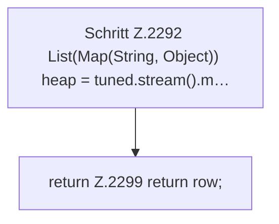

[[00 Start]] › [[Host-Betrieb]] › [[Host-Minimieren]] › [[Host-Minimieren.Teil1]] › [[FabricLauncherPlugin.hostMinimizeApply]] › [[FabricLauncherPlugin.hostMinimizeApply.Teil2.Z2292]]

# FabricLauncherPlugin.hostMinimizeApply.Teil2.Z2292



```knoten
Schritt Z.2292 List(Map(String, Object)) heap = tuned.stream().m…
  Zeile 2292: `List(Map(String, Object)) heap = tuned.stream().m…`
return Z.2299 return row;
  Zeile 2299: Rückgabe `return row;`.
```

> [!knoten]- Was die Blöcke tun
> - **Schritt Z.2292 List(Map(String, Object)) heap = tuned.stream().m…**: Zeile 2292: `List(Map(String, Object)) heap = tuned.stream().m…`
> - **return Z.2299 return row;**: Zeile 2299: Rückgabe `return row;`.

- Der Ablauf geht in [[Glossar#Zeile|Zeile]] 2292 weiter. Eine Ebene tiefer steht er genauer.
- Fortsetzung von `FabricLauncherPlugin.hostMinimizeApply.Teil2`.
